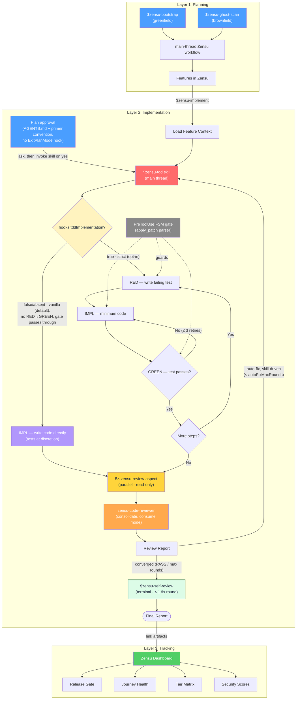

# Zensu for Codex


**Product Lifecycle Manager — features as first-class citizens, for the [OpenAI Codex CLI](https://developers.openai.com/codex/).**

`zensu-codex` is the [Zensu](https://zensu.dev) Product Lifecycle Manager packaged as a native plugin for the [OpenAI Codex CLI](https://developers.openai.com/codex/). It delivers feature tracking, strict RED→GREEN TDD with a phase-gated edit guard, a five-perspective code-review chain, security reviews, release-readiness gating, and greenfield/brownfield onboarding — as a Codex plugin: a `.codex-plugin/plugin.json` manifest, `skills/`, `agents/` (subagents), and `hooks/`, installed through Codex's native plugin system. The plugin drives Zensu through the typed [`zensu` CLI](https://zensu.dev) (≥ 0.2.0); the hosted MCP server stays live for the Zensu web app's own assistant but is no longer wired into the plugin. Per-release changes are tracked in [CHANGELOG.md](CHANGELOG.md).

> **Status:** installable from the GitHub marketplace below. Its production
> source is pinned to the immutable tag matching the plugin version; ordinary
> merges to `main` cannot silently replace installed plugin bytes.

---

## Table of contents
- [What is Zensu?](#what-is-zensu)
- [Agent & workflow overview](#agent--workflow-overview)
- [Requirements](#requirements)
- [Install](#install)
- [Authentication](#authentication)
- [What you get](#what-you-get)
  - [The zensu CLI](#the-zensu-cli)
  - [Skills](#skills)
  - [Subagents](#subagents)
  - [Lifecycle hooks](#lifecycle-hooks)
- [The TDD engine](#the-tdd-engine)
- [Configuration](#configuration-zensuconfigjson)
- [Troubleshooting](#troubleshooting)
- [Capabilities & enforcement on Codex](#capabilities--enforcement-on-codex)
- [Repository layout](#repository-layout)
- [Uninstall](#uninstall)
- [How it's built](#how-its-built)
- [License](#license)

---

## What is Zensu?

Zensu is a SaaS Product Lifecycle Manager (PLM) that treats **features as
first-class citizens** across the entire software lifecycle — from roadmap to
release. The CLI plugin is the in-terminal front door to that SaaS, plus a
stack-agnostic TDD/review discipline engine that works even with no account.

Core model:
- **Organizations → Products.** A product owns **Components** (domain modules),
  **Tiers** (pricing levels with feature gating), **Features**, and **User Journeys**.
- **Features** carry `ZEN-XXX` IDs (e.g. `ZEN-001`), referenced in commits as
  `[ZEN-001]`. Status lifecycle: `planned → in-progress → testing → released`,
  gated by a **security score** (0–10), **docs completeness**, and **journey health**.
- Per-feature build-out runs along two axes: **revisions** (`zensu features revision`,
  v1/v2…, stages over time) and **subfeatures** (`zensu subfeatures add`, structural parts).

Three layers of behavior:
1. **Planning (what):** main-thread `$zensu-bootstrap` (greenfield) /
   `$zensu-ghost-scan` (brownfield) / hybrid workflows. The neutral
   `zensu-plm` subagent may advise from project files, but never receives CLI,
   Session Control, shell, or workflow-mutation authority.
2. **Implementation (how, securely):** `$zensu-tdd` — strict RED→GREEN TDD,
   enforced by a PreToolUse phase-gate, followed by a five-perspective review chain.
3. **Tracking (progress):** a web dashboard (outside this repo) fed by the same Zensu backend.

---

## Agent & workflow overview

Zensu's three-layer flow, with the Codex
specifics baked in: skills are invoked as `$zensu-x`, the plan-approval ask is
an `AGENTS.md` + primer convention (Codex has no `ExitPlanMode` hook event), the
review chain fans out five explicitly-spawned `zensu-review-aspect` subagents
before consolidating through `zensu-code-reviewer`, and the auto-fix loop is
skill-driven (backstopped by the advisory Stop hook). The Implementation layer
shows both modes: **vanilla** (the default — no RED→GREEN ceremony, the edit
gate passes through, review chain and evidence audits stay enforced) and
strict RED→GREEN, opt-in via `hooks.tddImplementation=true`.



---

## Requirements

- **Zensu CLI ≥ 0.2.0** (`zensu --version`) on `PATH` — the plugin drives Zensu
  through it. Install: `curl -fsSL https://zensu.dev/install.sh | sh`, then
  `zensu auth login`.
- **Codex CLI 0.144.1** (`codex --version`) is the validated and eval-pinned
  host version for the current plugin/session-control contract.
- **Node.js 20+** (the production Session Control hooks use Node for validated
  JSON, hashing, immutable records, and compare-and-swap workflow state; CI
  validates the runtime on Node 20).
- **bash** + **git** (the hooks and installer are POSIX bash; macOS/Linux, or
  Windows via WSL/Git Bash).

---

## Install

```bash
# 1. Install the Zensu CLI (the plugin drives Zensu through it) and sign in
curl -fsSL https://zensu.dev/install.sh | sh
zensu auth login          # browser OAuth2 + PKCE (see Authentication)

# 2. Register the GitHub marketplace
codex plugin marketplace add MKITConsulting/zensu-codex

# 3. Install the plugin (interactive picker)
codex /plugins            # select "Zensu" -> Install

# 4. Enable + trust the lifecycle hooks (TDD gate, witness, stop-enforcer, banner)
codex --enable plugin_hooks   # eval-pinned 0.144.1 only; for 0.157.1 and 0.163.0 see the heads-up below
codex /hooks                  # review -> Trust the zensu hooks

# 5. Codex 0.157.1 and 0.163.0: install the subagent roles where Codex finds them
mkdir -p "${CODEX_HOME:-$HOME/.codex}/agents"
cp "${CODEX_HOME:-$HOME/.codex}"/plugins/cache/zensu/zensu/<version>/agents/*.toml "${CODEX_HOME:-$HOME/.codex}/agents/"
```

Installing the plugin registers its components straight from
`.codex-plugin/plugin.json`: the 14 skills and the lifecycle hooks
(`hooks/hooks.json`). Codex 0.157.1 and 0.163.0 do not load a plugin's `agents/`
directory, so step 5 copies the 3 subagent roles into `$CODEX_HOME/agents/`
(`CODEX_HOME` defaults to `~/.codex`); `<version>` is the installed plugin version
(`ls "${CODEX_HOME:-$HOME/.codex}/plugins/cache/zensu/zensu/"`). The copies do not
follow plugin updates, so repeat step 5 after every update.
Zensu data access goes through the `zensu` CLI you installed in step 1 — the
hosted MCP server is no longer wired into the plugin. Restart Codex (or open a
new session) afterward.

(Optional) To carry the Zensu conventions even with hooks disabled, append this
repo's `AGENTS.zensu.md` to `~/.codex/AGENTS.md`.

### Trust the hooks (required, and again after updates)

Codex does not run any **non-managed** hook until you review and trust it — a
security gate that applies to user, project, AND plugin hooks alike. After
installing, start Codex and run **`/hooks`**: inspect the zensu hook sources and
**Trust** them. Until you do, the TDD phase-gate, the test witness, the Stop
chain-enforcer, and the session banner stay inactive (Codex prints a startup
warning telling you to open `/hooks`). Trust is keyed to each hook's content hash,
so after a plugin update that changes a hook you re-trust it via `/hooks`. On
Codex 0.157.1 a change to a hook's `hooks.json` entry — its command or its name
(`statusMessage`) — marks that hook `modified`, while a change to the script it
runs does not. Codex skips a `modified` hook without notice, so re-trust every
Zensu hook together: when the Session Control SessionStart hook is skipped while
the gates still run, the gates deny every edit until it is trusted again. On
Codex 0.166.0 every plugin update marks every Zensu hook `modified`, whatever it
changed, so trust them all again in `/hooks` after each update; until then an
open chat runs no Zensu hook at all. Once they are trusted, the open chat
re-binds its Session Control record to the updated plugin on its next message
and says so once, and a chat you reopen re-binds at its resumed `SessionStart`.
Reopen the chat as well when it does not recover after the re-trust: a re-trust
in the `/hooks` dialog while a chat is loaded is not measured.
Only enterprise **managed** hooks (`requirements.toml`) skip this review. On
Codex 0.157.1, 0.163.0 and 0.166.0, `codex exec` and the app server skip
untrusted hooks without any notice, so an unattended run on an untrusted install
has every Zensu hook off.

> **Heads-up on hooks (0.144.1):** plugin-bundled hooks execute only when the
> `plugin_hooks` feature is enabled (step 4) and the installed hook bytes are
> trusted. Skills, subagents, and the `zensu` CLI do **not** depend on hook trust.
> When plugin hooks do run, Codex injects `CLAUDE_PLUGIN_ROOT` into their
> environment, which the hook scripts use to resolve the plugin root. See the
> capability matrix below.
>
> **On Codex 0.157.1 and 0.163.0** plugin hooks ran with no `[features]` table in
> `config.toml` at all, measured in one `codex exec` run with
> `--dangerously-bypass-hook-trust`; a trusted run without the table is not
> measured yet. Untrusted plugin hooks did not run in `codex exec` or in the app
> server, so the `/hooks` trust step stays required. The statements about these
> two versions in this README come from the recorded host probe; see
> [docs/codex-port.md](https://github.com/MKITConsulting/zensu-codex/blob/main/docs/codex-port.md).

---

## Authentication

The plugin drives Zensu through the typed `zensu` CLI, which talks to the Zensu
backend (default `https://api.zensu.dev`). Authenticate the CLI once:

- **OAuth (default, interactive):** sign in through the browser (OAuth2 + PKCE):
  ```bash
  zensu auth login
  zensu auth status     # verify; `zensu auth logout` clears credentials
  ```
- **API key (CI / headless):** log in with a key instead of the browser:
  ```bash
  zensu auth login --with-token zsk_...      # or:  echo "$ZSK" | zensu auth login --with-token -
  ```
- **Self-hosting:** point the CLI at your own endpoint, by flag or environment.
  Resolution order: `--api-url` flag → `ZENSU_API_URL` → stored host → `https://api.zensu.dev`.
  ```bash
  zensu auth login --api-url https://api.example.internal
  # or, per-invocation:
  export ZENSU_API_URL=https://api.example.internal
  ```

> **MCP note.** The hosted MCP server at `https://mcp.zensu.dev/mcp` is **no
> longer wired into the plugin** — it stays live for the Zensu web app's own AI
> assistant. Earlier `zensu-codex` releases registered it via `.mcp.json`; that
> file has been removed (see [CHANGELOG](CHANGELOG.md)).

> **Graceful degradation:** the TDD engine, code review, and progress logging
> work with **no Zensu account / no CLI sign-in**. The `zensu` CLI only augments
> the flow (auto-link tests/sources, status updates, revisions, release gating).

---

## What you get

### The zensu CLI

A GitHub-CLI-style binary (`zensu <noun> <verb>`) covering the full surface —
feature CRUD, subfeatures, linking, security, revisions, lifecycle, tiers,
journeys, bootstrap, product studio, docs context, wiki, knowledge search, pulse,
and ghost-scan. Main-thread skills invoke it by command
(`zensu features create`, `zensu ghost scan`, …); every command takes `--json`
and documents its flags via `zensu <noun> <verb> --help`. The neutral
`zensu-plm` subagent may analyze project files but never invokes the CLI.
Driving the typed CLI
instead of the 74-tool MCP surface reclaims ~22k context tokens per request.

### Skills

Invoke with `$name` (or via the `/skills` menu). Each is a `SKILL.md` with YAML
`name`/`description` frontmatter (Codex's trigger mechanism).

| Skill | Purpose |
|---|---|
| `$zensu-bootstrap` | Greenfield: create product + vision, decompose into components/features, post-bootstrap setup. |
| `$zensu-ghost-scan` | Brownfield: scan a repo for features (multi-lens), apply, discover journeys, seat a v1 baseline. |
| `$zensu-implement` | Implement a tracked feature end-to-end (context → TDD → link artifacts → revision → validate). |
| `$zensu-tdd` | The heart: strict RED→IMPL→GREEN, phase-gated, with a guaranteed review chain. |
| `$zensu-plan-review` | Pre-implementation gate: a tailored multi-perspective reviewer panel returns GO / REVISE / NO-GO. |
| `$zensu-security-review` | Classify → analyze → suggest+link tests → STRIDE threat model → complete → validate. |
| `$zensu-self-review` | Terminal self-reflection across 7 dimensions; owns the review-chain terminus. |
| `$zensu-reset-review-limit` | Reset the auto-fix round counter and re-arm the review chain. |
| `$zensu-pulse` | Developer journal: start/end a dev session, review activity. |
| `$zensu-help` | Read-only Q&A about Zensu concepts and workflows. |
| `$zensu-pr-team-review` | Multi-agent PR review: auto-cast a persona team, review in parallel, publish one consolidated GitHub review via `gh api`. |
| `$zensu-pr-fix-findings` | Resolve every open PR review comment end-to-end: fix via the Zensu workflow, push, resolve threads, report back. |
| `$zensu-autopilot` | Idea → ready, validated PR autonomously: one plan gate, then build + team-review + fix + validate-loop. Never auto-merges. |
| `zensu:zen-mode` | Low-noise answers: the result first, a short session block, one next step, and the Zensu chain-progress line while a review chain runs. On by default; its `--on`/`--off` verbs record the choice per session, and `zen off` or `normal mode` leaves it in-band. It uses a bare `name`, so Codex lists it under the plugin namespace. |

### Subagents

Codex subagents (`agents/*.toml`), spawned explicitly when you ask Codex to use them. On Codex 0.157.1 and 0.163.0 they can be spawned by name only after install step 5 has copied them into `$CODEX_HOME/agents/`. Until then, with no role installed, Codex offers no `agent_type` choice and a spawn runs as `default`, which the capability gate treats as a neutral subagent that may edit project files.

| Agent | Role |
|---|---|
| `zensu-plm` | Neutral product-analysis helper. It can reason from project files, but cannot run shell/CLI/control tools or acquire `main-v1`; mutations remain in the main-thread `$zensu-*` skills. |
| `zensu-code-reviewer` | Packet-only consolidation reviewer for conventions, bugs, architecture, tests, and security. On the eval-pinned 0.144.1 its host profile disables shell/unified-exec, web, image, multi-agent, app, goal, approval, login-shell, and inherited MCP capabilities. On 0.157.1 and 0.163.0 the same profile removes only the shell tools, and the PreToolUse capability gate denies its hooked tool calls; in code mode its outer `exec` tool fires no hook, so a code-mode reviewer is not confined yet (see the capability matrix). The main thread supplies complete relevant diff hunks, governing guidance, source excerpts, and test/build evidence. |
| `zensu-review-aspect` | Packet-only single-perspective reviewer; five run in parallel for the TDD review chain. It uses the same profile and capability gate, with the same code-mode limit, and otherwise cannot discover missing evidence itself. |

### Lifecycle hooks

All hooks read the host's JSON payload on stdin and emit the host's hook output
schema. They resolve the plugin root from Codex's trusted hook environment or
self-resolution, and the project dir from payload `cwd`. User-facing reminder,
banner, witness, and chain hooks honor `~/.zensu/config.json`; the Session
Control registration and principal-capability boundary are mandatory and fail
closed rather than exposing an opt-out flag.

| Event (matcher) | Script | What it does |
|---|---|---|
| `SessionStart` | `session-start-session-control.sh` | Binds the exact executed plugin/worktree, project, version, and full runtime digest to a private Session Control v1 record. Its identity fields (host, session hash, project root, control root, principal profiles, `created_at`) never change on their own; a resumed `SessionStart` after a plugin update re-binds only the installation fields (plugin root, version, runtime digest, source revision), any identity difference fails closed, and only the user's own `zensu reanchor` message moves the project root (see `user-prompt-session-control.sh`), as long as the sandbox keeps the model's shell from writing `~/.zensu/session-control`. `source_revision` is always exactly that `sha256:<runtime-digest>` content identity; ambient revision/authority overrides fail closed. Exact Git identity exists only in separately sealed eval/release evidence. It injects the domain-separated `ZENSU_SESSION_KEY` into trusted main context; the independent stable-reader ABI v3 lives under `~/.zensu/session-control/codex/v3/`. |
| `SubagentStart` | `session-start-session-control.sh` | Reuses the parent session record and requires its plugin root to equal the currently executing plugin copy. Exact reviewer profiles receive packet-only `reviewer-readonly-v1`; every other subagent, including built-ins and `zensu-plm`, receives neutral `host-profile-v1` with no selector or root disclosure. Only a true top-level payload without agent fields receives `main-v1`. |
| `SessionStart` | `session-start-pulse.sh` | Prints a HEAD/branch readiness line. |
| `SessionStart` | `session-start-banner.sh` | User-facing "Zensu PLM active" banner (fresh starts only). |
| `SessionStart` | `session-start-primer.sh` | Model-facing orientation (plan → ask about `$zensu-tdd`). |
| `SessionStart` | `session-start-ai-work.sh` | Instructs the agent to capture an already agreed implementation goal using personal CLI OAuth, also during direct implementation. Session startup alone creates no work. |
| `PreToolUse` (`*`) | `pre-reviewer-capability-gate.sh` | Revalidates the bound Session Control context and mandatory baseline state on every tool call; when a plugin update replaced the bound installation, a main-thread call first re-binds it under the rules of `user-prompt-session-control.sh`. It names the `/hooks` re-trust remedy when revalidation fails, and the `zensu reanchor` message when the call runs outside the bound project root. Packet-only reviewers receive no tools. Every other subagent is neutral: shell, agent, skill, MCP/control, Session Control, workflow-state, out-of-project, and unknown tools fail closed; only explicit project-bound file tools are eligible. Ambient identity markers are ignored. |
| `PreToolUse` (`apply_patch`/`Edit`/`Write`/`MultiEdit`) | `pre-edit-tdd-reminder.sh` | **The TDD phase-gate** — denies production edits until a failing test exists. After a plugin update it first re-binds a stale record for a main-thread edit, under the rules of `user-prompt-session-control.sh`. |
| `PreToolUse` (`shell`/`Bash`/`exec_command`/`exec`) | `pre-bash-source-write-gate.sh` | Blocks raw shell writes (`>>`, `tee`, `sed -i`, `dd of=`) that clobber tracked source or escape the worktree into a sibling checkout. |
| `PostToolUse` (`shell`/`Bash`/`exec_command`/`exec`) | `post-bash-witness.sh` | Records every shell command to a witness log (anti-hallucination evidence). |
| `Stop` | `stop-chain-enforcer.sh` | Backstops the review chain (don't end a TDD turn before review completes). After a plugin update it first re-binds a stale record, under the rules of `user-prompt-session-control.sh`, before it judges the stop. |
| `Stop` | `stop-ai-work-capture.sh` | Submits new clean Git commits for an explicitly begun work goal, retries durable receipts, and returns the version-bound web review link. Never accepts or revokes a result. See [automatic work capture](https://github.com/MKITConsulting/zensu-codex/blob/main/plugins/zensu/docs/ai-work-capture.md). Requires a CLI/backend with `ai-work context/start/get/submit`; unavailable capture is reported without blocking coding. |
| `UserPromptSubmit` | `user-prompt-context-nudge.sh` | Suggests `/compact` when context occupancy crosses a threshold. |
| `UserPromptSubmit` | `user-prompt-intent-router.sh` | On a product/planning keyword, nudges the main thread to run project-context triage and choose the appropriate `$zensu-*` skill. |
| `UserPromptSubmit` | `user-prompt-tdd-reminder.sh` | Per-turn reminder to ask about `$zensu-tdd` before implementing code (Codex has no plan-approval event). |
| `UserPromptSubmit` | `user-prompt-session-control.sh` | Re-binds an open chat after a plugin update. Codex fires no `SessionStart` for an open thread, so once the hooks are trusted again, the main thread's next prompt re-binds the record's installation fields to the executing copy. Like a resumed `SessionStart` it keeps every identity field, the project included; unlike it, it re-binds only to a copy of the same plugin next to the bound one and never to an older version, and it refuses a missing or unreadable workflow state. It tells the model once; a refusal names its reason and asks for a new chat. It also re-anchors a chat whose working directory moved, for example after the Codex desktop app attached a new worktree to it: every prompt from the moved directory says so, and only the user's own message `zensu reanchor` moves the record's project root there, as long as the sandbox keeps the model's shell from writing `~/.zensu/session-control`. It moves only into a registered, non-prunable worktree of the same repository (the same git common dir), at the same place in it as the old root in its own, and never into a worktree that contains the old root or another worktree. It changes the project root and nothing else, keeps the previous record beside the new one, starts a fresh workflow state in the new worktree when it has none and keeps a usable one, and refuses while the old root holds open work unless the user sends `zensu reanchor --discard-open-work`, which closes that work. After a plugin update it re-binds the installation in the same step. Payloads with agent fields are ignored. |
| `UserPromptSubmit` | `user-prompt-zen-mode.sh` | While zen-mode is on for the session, injects the low-noise answer contract on every main-thread prompt, closed by a `ZENSU CHAIN ANCHOR` field. The anchor comes only from the session's workflow state, read through the Session Control record: `Zensu: ▶implement ·review ·self-review` while implementing, `Zensu: ✓implement ▶review ·self-review` during review (both without `·self-review` when `hooks.selfReview` is `false`), and `none` without an armed chain, once the review has converged or the chain is closed, and on any read fault. An off phrase (`zen off`, `zen-mode off`, `turn off zen`, `stop zen`, or `normal mode` as the whole prompt) records the choice and switches the mode off. Payloads with agent fields are ignored. It is appended as its own group, so it reads `untrusted` in `/hooks` until you trust it. |

Two hooks have **no matching Codex event** and are kept as the canonical
reference implementation (their behavior is carried by `AGENTS.md` + skill
prose): `plan-approved-delegate.sh` (plan-approval) and
`post-review-tdd-delegate.sh` (subagent-completion auto-fix loop).

### Session Control trust boundary

Session Control enforces host-tool principals, exact session/project binding,
validated state shape, atomic revisions, and fail-closed hook decisions. Its
workflow document currently lives under the project-local `.zensu/state/`
directory, however, and is not a cryptographically signed or broker-owned authority.
User-authorized build/test scripts, external processes, or a
fully-privileged main process running as the same OS user are therefore inside
the trust boundary: they can modify project files or invoke main-only workflow
verbs. Run untrusted project code in an OS sandbox that denies writes outside
its intended outputs. Neutral/reviewer agents and ordinary gated model tools
remain outside that boundary. Absolute protection from malicious same-user
processes requires a future host-mediated private authority plus
host-authenticated stage receipts; pathname checks alone cannot eliminate same-user time-of-check/time-of-use races.

---

## The TDD engine

`$zensu-tdd` runs strict, one-step-at-a-time RED→GREEN TDD. Each step declares
its phase through the helper:

```bash
# Use the exact scv1_… value from trusted SessionStart context. Repeat this
# export at the start of every new root-dependent shell tool call.
export ZENSU_SESSION_KEY='<injected scv1_…>'
PLUGIN_ROOT="$(node "$HOME/.zensu/session-control/codex/v3/resolve-v3.js")" && bash "$PLUGIN_ROOT/hooks/lib/zensu-log.sh" --tdd-begin  # exact record; arm gate + witness
PLUGIN_ROOT="$(node "$HOME/.zensu/session-control/codex/v3/resolve-v3.js")" && bash "$PLUGIN_ROOT/hooks/lib/zensu-log.sh" --phase RED_WRITE --step 1
# write a failing test, run it…
PLUGIN_ROOT="$(node "$HOME/.zensu/session-control/codex/v3/resolve-v3.js")" && bash "$PLUGIN_ROOT/hooks/lib/zensu-log.sh" --phase RED_FAIL --step 1 --reason "asserts X"
PLUGIN_ROOT="$(node "$HOME/.zensu/session-control/codex/v3/resolve-v3.js")" && bash "$PLUGIN_ROOT/hooks/lib/zensu-log.sh" --phase IMPL --step 1
# implement until green, then GREEN_RUN / GREEN_PASS, optionally REFACTOR
```

The **phase-gate** (`pre-edit-tdd-reminder.sh`) reads the per-session FSM state
and allows/denies each edit:

| Phase | Test file | Production file |
|---|---|---|
| `RED_WRITE` | allow | allow |
| `RED_FAIL` | allow | **deny** |
| `IMPL` | allow (after a `RED_FAIL` for the step) | allow (after `RED_FAIL`) |
| `GREEN_PASS` | allow | **deny** |
| `REFACTOR` | allow | allow |
| `UNINITIALIZED` | deny | deny |

On Codex the gate parses the freeform `apply_patch` envelope (`*** Update/Add/
Delete File:` lines) — a patch touching several files is denied if **any** file
violates the current phase. Vanilla mode is the default; setting `hooks.tddImplementation=true` opts in to
the strict gate. In vanilla mode — `--tdd-begin` reads the config ONCE, freezes the
mode into the session state (echoing `mode: vanilla`; query later with
`zensu-log.sh --mode`), the gate passes through (the `.zensu/state/` deny stays),
and the RED→GREEN ceremony is dropped while the evidence audits and review chain
stay enforced. Config flips mid-session change nothing; the ask-before-implementation
flows keep asking, worded "Zensu workflow (vanilla implementation + review chain)".
Beware: a project-local `.zensu/config.json` checked into a repository pre-selects
the mode for every clone (the project file's keys deep-merge over the global
config, so `hooks.tddImplementation` set there wins per key) — and the same file can also set
`hooks.sessionBanner=false`, silencing the banner signal, which leaves the `mode:`
echo at `--tdd-begin` as the only per-session signal of an unexpected downgrade.
Full docs: [TDD workflow](https://github.com/MKITConsulting/zensu-codex/blob/main/plugins/zensu/docs/tdd-manager-workflow.md).
Documentation authoring rules: [documentation guide](https://github.com/MKITConsulting/zensu-codex/blob/main/plugins/zensu/docs/documentation-guide.md).

---

## Configuration (`~/.zensu/config.json`)

Resolution: `$ZENSU_CONFIG` is a full override (read verbatim, no merge). Otherwise
the project `$CLAUDE_PROJECT_DIR/.zensu/config.json` is **deep-merged per key over**
the global `$HOME/.zensu/config.json` — the project wins per key, and keys it omits
fall through to the global instead of shadowing it wholesale. A missing file or key
means "enabled". Copy `config.example.json` to start.

| Key | Default | Effect |
|---|---|---|
| `hooks.autoTdd` | `true` | Plan→ask-about-TDD directive (advisory on Codex; see the capability matrix). |
| `hooks.tddImplementation` | `false` | **Vanilla mode is the default** (parity with zensu-claude-code); explicit `true` opts in to strict RED→GREEN. Vanilla drops the ceremony and phase markers; the edit gate passes through (`.zensu/state/` edits stay denied), tests at the agent's discretion; evidence audits + review chain stay enforced. Frozen per session at `--tdd-begin` (echoes `mode: …`; details in [The TDD engine](#the-tdd-engine)). |
| `hooks.chainEnforcer` | `true` | Stop-hook review-chain backstop. |
| `hooks.autoFix` | `true` | Auto-fix loop behavior (skill-driven on Codex). |
| `hooks.autoFixIncludeSuggestions` | `false` | Route all severities vs Critical+Important only. |
| `hooks.autoFixMaxRounds` | `5` (1–99) | Review→fix round cap + stop-block budget (`cap+3`). |
| `hooks.combinedSummary` | `true` | Render the 3-section chain-end summary. |
| `hooks.selfReview` | `true` | Terminal `$zensu-self-review` stage owns the chain terminus. |
| `hooks.pulseSession` | `true` | SessionStart HEAD/branch readiness line. |
| `hooks.sessionBanner` | `true` | User banner + model primer on fresh starts. |
| `hooks.intentRouter` | `true` | UserPromptSubmit nudge toward the product-planning triage on a Zensu keyword. |
| `hooks.tddReminder` | `true` | Per-turn UserPromptSubmit reminder to ask about `$zensu-tdd` before code edits. |
| `hooks.zenMode` | `true` | Runs the zen-mode UserPromptSubmit hook. `false` stops the per-prompt contract; recorded choices stay on disk. |
| `hooks.zenModeDefault` | `true` | What a session without a recorded zen-mode choice resolves to. `false` makes the mode opt-in through the `zen-mode` skill's `--on` verb. |
| `context.compactionNudge` | `true` | `/compact` nudge on/off. |
| `context.nudgeThreshold` | `50` (1–99) | Occupancy % at which the nudge fires. |
| `context.windowSize` | unset | 100%-denominator token budget (unset → auto-tier 200k/1M). |
| `logging.timestampStyle` | `wall` | `wall` `[HH:MM:SS]` \| `relative` `[+HH:MM:SS]` \| `none`. |

**Environment overrides:** `ZENSU_CONFIG` (config path), `ZENSU_TDD_GATE=off`
(disable the phase-gate), `ZENSU_TEST_WITNESS=off`, `ZENSU_CHAIN=off` (disable
the Stop backstop), and `ZENSU_API_URL` (self-host the `zensu` CLI's backend).
Without `ZENSU_CHAIN=off`, a Stop the backstop cannot judge — an unresolvable
Session Control record, or a missing or invalid session-state file — is blocked
at most three consecutive times per session and then released with a warning,
while edits and the chain terminus stay blocked; a valid state resets the count.
Model-issued helper commands deliberately do not use those overrides: the main
thread exports the exact `ZENSU_SESSION_KEY=scv1_…` injected by `SessionStart`,
then resolves that record through `$HOME/.zensu/session-control/codex/v3/resolve-v3.js`
and fails closed. Reader ABI v3 is independent of the immutable Session Control
v1 record schema; prior `codex/v1` and `codex/v2` reader/record artifacts remain inert and
are never migrated. Published reader ABI files and namespaces are immutable:
any byte or semantic change requires a new namespace and filename (for example,
`v4/resolve-v4.js`) and must never overwrite v3 in place. There is no host-id,
environment-root, project-variable, current-pointer, or
working-directory fallback. Every model-issued helper call requires the exact
injected key and resolves both plugin and project roots through reader ABI v3.
Executable hooks resolve their own plugin root from their on-disk entry path,
so inherited root variables cannot redirect them to another checkout.

---

## Troubleshooting

- **`zensu: command not found`** — the CLI is not on `PATH`. Install it with
  `curl -fsSL https://zensu.dev/install.sh | sh` and reopen your shell. The
  session banner warns when `zensu` is missing.
- **Auth errors (401 / "not logged in")** — run `zensu auth login` (or
  `zensu auth login --with-token zsk_...` for CI), then verify with
  `zensu auth status`.
- **Self-hosted backend** — `zensu auth login --api-url <url>`, or export
  `ZENSU_API_URL`. Resolution order: `--api-url` → `ZENSU_API_URL` → stored host
  → `https://api.zensu.dev`.
- **Hooks not firing** — the TDD phase-gate, witness, Stop backstop, and banner
  are plugin hooks: enable plugin hooks and **Trust** them via `codex /hooks`
  (see Install). They are independent of Zensu CLI auth.
- **Zensu stops working after a plugin update** — on Codex 0.166.0 an update
  marks every Zensu hook `modified`, and Codex skips them without notice: open
  `/hooks` and trust every Zensu hook again. The next message, main-thread tool
  call or turn end re-binds the open chat to the updated plugin; if it does not,
  reopen the chat. If Zensu says it cannot re-bind the chat, start a new one.
- **Every tool call is denied with `tool project does not match immutable
  context`** — the chat now works in another directory than the one its
  Session Control record names, for example after the Codex desktop app
  attached a new worktree to it. If that directory is another worktree of the
  same repository, send the message `zensu reanchor` on its own: Zensu moves
  the record there, keeps everything else, and the chat continues. While the
  old directory still holds open work, such as an armed review chain, Zensu
  refuses and names `zensu reanchor --discard-open-work`, which moves the
  record anyway and closes that work. In every other case, start a new chat in
  the new directory.
- **Exact plugin root cannot be resolved** — start a fresh main-thread Codex
  session so the trusted `SessionStart` registration hook can recreate the
  exact record. Do not search records or recover from a shared/project-local
  pointer; a missing injected `ZENSU_SESSION_KEY` fails closed by design.
  An interrupted registration can leave a private lock or publication
  candidate. A later SessionStart recovers only a lock whose owner is proven
  dead and never deletes a live owner's or raced replacement's artifact.
- **A `zensu` mutation ran outside a skill/agent** — Codex does **not** gate
  `zensu` CLI mutations (a write-gate is not wired on Codex; see the capability
  matrix). Route product changes through the main-thread `$zensu-*` skills to
  keep the workflow conventions (dedup, journeys, baseline revisions,
  security classification, release-readiness).

---

## Capabilities & enforcement on Codex

On the eval-pinned Codex 0.144.1 most of Zensu's behavior is hook-enforced. A few capabilities
depend on host events Codex does not expose, or on payload/tool-name shapes the
hooks adapt to; those degrade to advisory or skill-driven. This matrix is the
honest map of what's enforced versus advisory.

| Capability | On Codex | Enforcement on 0.144.1 |
|---|---|---|
| Plugin manifest | `.codex-plugin/plugin.json` | **full** |
| Zensu backend access | typed `zensu` CLI (MCP server unwired) | **full** |
| Zensu write-gate (workflow enforcement) | **not wired** (deferred) — `PreToolUse(shell)` does not fire reliably on Codex | **advisory** |
| Skills | `skills/*/SKILL.md` (+ YAML frontmatter), invoked `$zensu-x` | **full** |
| Subagents | `agents/*.toml`, **explicit spawn** | **partial** — no proactive auto-delegation. On 0.157.1 and 0.163.0 the plugin's `agents/` directory is not loaded; the roles work only after install step 5 copies them into `$CODEX_HOME/agents/` |
| Persistent instructions | `AGENTS.md` (global block) + SessionStart primer | **full** |
| `SessionStart` hooks | exact-root record (fixed identity, installation re-bound on resume, or in an open chat by its next prompt, main-thread tool call or Stop) + mandatory revision-one baseline + banner/primer/pulse | **full** |
| `PreToolUse` TDD gate | `apply_patch` (parse patch) + Edit/Write, **deny** | **full** |
| `PostToolUse` witness | `shell`/`Bash`/`exec_command`/`exec` tools (argv array normalized, `Exit code:` envelope parsed) | **full** |
| `UserPromptSubmit` nudge | parser is Claude-transcript-shaped | **partial** — likely inert until adapted to Codex's rollout format |
| `Stop` review backstop | `{decision:block}` re-prompt + mode-aware fix wording (see CHANGELOG 0.2.0); Codex Stop can't hard-block | **advisory** |
| Plan-approval → ask TDD | **no host event** → `AGENTS.md` + primer convention | **advisory** |
| Auto-fix loop | **no host event** → `$zensu-tdd` skill prose + Stop backstop | **skill-driven** |
| Review chain (5 aspects) | `zensu-review-aspect` subagents (explicit spawn, parallel) | **partial** — parallel, but explicitly requested |
| Reviewer capability boundary | Packet-only per-agent profile: read-only sandbox; shell/unified-exec, web, image, multi-agent, apps, goals, approvals, login shell, and inherited MCP servers disabled | **host-enforced** on 0.144.1; the version-bound `PreToolUse.agent_type` denial is additive only when the host exposes a documented non-default reviewer name; ambiguous `default` receives neutral `host-profile-v1` session context. On 0.157.1 and 0.163.0 the host enforces only the shell removal: the role's `sandbox_mode = "read-only"` does not stop writes, and `apply_patch`, the multi-agent and goal tools, `view_image`, `request_user_input` and the code-mode `exec` tool stay offered, on 0.163.0 also the three MCP resource tools. There the boundary is **hook-enforced**, and only while the hooks are trusted: subagent tool payloads carry the role name as `agent_type`, and the capability gate denies every tool call of a Zensu reviewer that reaches it. Three limits remain open. The code-mode `exec` tool fires no PreToolUse, so a code-mode reviewer is not confined until that runtime is measured. The gate's `.*` matcher is not part of the recorded probe, so whether it catches every hooked tool, the code-mode spawn and wait tools included, is not measured. A deny inside a subagent was measured for `Bash`, `apply_patch` and spawning only, and only with `--dangerously-bypass-hook-trust`. A project `.codex/agents/` role with a Zensu reviewer name overrides the installed role, also in an untrusted project, so a repository can replace a reviewer's instructions; see [docs/codex-port.md](https://github.com/MKITConsulting/zensu-codex/blob/main/docs/codex-port.md) |
| State machine / logging / config | `hooks/lib/*` with local hardening (CHANGELOG 0.2.0) | **full within the documented host-tool boundary**; not cryptographic authority against same-user project processes |
| Marketplace / install | `codex plugin marketplace add` + `codex /plugins` | **full** for skills/agents; plugin hooks are validated with eval-pinned Codex 0.144.1 and require `plugin_hooks` + `/hooks` trust. On 0.157.1 and 0.163.0 plugin hooks ran without `plugin_hooks` (measured only with `--dangerously-bypass-hook-trust`) and still need the `/hooks` trust, and agents need install step 5 |

**Bottom line.** Within the documented host-tool boundary, the crown-jewel TDD
phase-gate is **fully enforced** — its `PreToolUse` deny stops gated production
edits until a failing test exists. The
structural *guarantees* that depend on host events Codex does not expose — the
un-skippable Stop backstop, the auto-firing review loop, and a `zensu` CLI
write-gate — are strongly-instructed conventions instead (carried by `AGENTS.md`
and the skill prose). On the eval-pinned 0.144.1 Codex is actually *stronger*
in one place: the `zensu-review-aspect` subagent runs under an OS-enforced
`read-only` sandbox with every host tool family disabled in its own packet-only
profile. On 0.157.1 and 0.163.0 that no longer holds: the trusted PreToolUse
capability gate denies a reviewer's hooked tool calls, but in code mode the outer
`exec` tool fires no hook, so a code-mode reviewer is not confined until that
runtime is measured. The main
thread therefore supplies complete relevant diff hunks, governing guidance,
source excerpts, and verification evidence in `REVIEW PACKET v1`; reviewers
fail closed on an incomplete packet instead of discovering repository content.

---

## Repository layout

The repo is a Codex plugin **marketplace**; the plugin itself lives in a
subdirectory. The production descriptor points at that subdirectory on the
immutable release tag matching the manifest version. Local Promptfoo evaluations
can build an ephemeral marketplace with `scripts/create-local-codex-marketplace.js`
to exercise an installed checkout. GitHub CI and releases instead run the
deterministic non-Promptfoo gate at the exact clean SHA and bind release evidence
to the source plugin runtime digest.

```
zensu-codex/                             # repo = a Codex plugin marketplace
├── .agents/plugins/marketplace.json     # production source → immutable vX.Y.Z tag
├── README.md  CHANGELOG.md  LICENSE     # repo docs
├── AGENTS.md                            # repo guide (for working in this repo)
├── reference/                           # canonical agent definitions (source of truth for subagents)
├── tests/smoke.sh                       # offline checks
└── plugins/zensu/                       # ← the plugin root (.codex-plugin/plugin.json)
    ├── .codex-plugin/plugin.json        # Codex plugin manifest (skills, agents, hooks)
    ├── AGENTS.zensu.md                  # optional conventions block to append to ~/.codex/AGENTS.md
    ├── config.example.json              # ~/.zensu/config.json template
    ├── agents/                          # 3 subagents: zensu-plm, zensu-code-reviewer, zensu-review-aspect
    ├── skills/                          # 14 skills (SKILL.md w/ frontmatter)
    │   ├── bootstrap/  ghost-scan/  implement/  tdd/  plan-review/
    │   └── security-review/  self-review/  reset-review-limit/  pulse/  zensu-help/
    ├── hooks/                           # hooks.json + *.sh + lib/ (config, session, tdd-phase, log, runtime)
    ├── assets/                          # zensu-logo.svg: plugin icon (interface.logo + interface.composerIcon)
    └── docs/                            # tdd-manager-workflow.md, documentation-guide.md
```

---

## Uninstall

```bash
codex plugin marketplace remove zensu   # or uninstall via  codex /plugins
codex /hooks                            # untrust the zensu hooks (optional)
```

This removes the plugin's skills, subagents, and hooks. It leaves the `zensu` CLI
(uninstall separately), `~/.zensu/config.json`, and any project `.zensu/`
artifacts in place. If you appended `AGENTS.zensu.md` to `~/.codex/AGENTS.md`,
remove that block by hand. Restart Codex.

---

## Testing

`tests/run-all.sh` runs four modes (exit 0 iff every selected suite passes):

- **(no arg)** — deterministic only, no network / no Codex / no API: `tests/smoke.sh`,
  every `tests/structure/test-*.sh`, the offline `evals/config-gate/`, and the
  Session Control wrapper/contract self-checks. This is the complete local
  deterministic gate.
- **`--ci`** — deterministic non-Promptfoo suites only. This is what GitHub
  Actions runs on pushes, pull requests, and releases.
- **`--self-check`** — the above plus each live suite's skeleton (structure-only, no API).
- **`--live`** — the above plus the `codex exec`-driven suites (COSTS API credits; needs an
  authenticated `codex` CLI): `tests/e2e-{intent-router,context-nudge}/` and the reference
  eval `evals/tdd/` (proves Codex follows `$zensu-tdd` end to end, asserting on post-run
  state via `scripts/codex-promptfoo-wrapper.sh`).

Promptfoo `0.121.20` Session Control contract, live, four-way concurrent (three
repeats), and six-category reviewer-adversarial suites (five repeats per
attack) remain available locally. They grade only wrapper-owned
`[control-attestation]` JSON, never model prose. Live reviewer assertions require
an actual host-written child rollout, delivered attack token, read-only/never-
approve turn context, fail-closed not-proven capability status, and matching before/after
digests. Every local live/nightly/release case recomputes the clean exact-SHA
source and independently installed runtime digests, then seals the Git SHA as a
separate `SourceGitRevision:<sha>` hook marker and evidence-receipt field. The
Session Context remains content-addressed. The live parent uses a strict
credential-isolation profile: shell/unified exec, code-mode host tools,
web/browser/computer/image tools, apps, goals, inherited MCP servers, and the
inherited shell environment are disabled; the wrapper accepts only the expected
multi-agent coordination calls in the parent trace. See
`evals/session-control/README.md` for the
fail-closed credential, exact plugin-root, evidence-receipt, and source-SHA
prerequisites. GitHub Actions never invokes Promptfoo or accepts model
credentials; release publication instead uses deterministic exact-SHA,
clean-tree, runtime-digest, version/ref, asset-digest, and Immutable Releases
gates.
`evals/tdd/README.md` documents the legacy end-to-end TDD eval.

CI also has a dedicated `windows-latest` Git Bash gate for the shared Session
Control Core and the complete Codex Session Control / stable-resolver-v3 suite.
Windows-specific skips are limited to POSIX mode and unprivileged
symlink-creation assertions. The portable process-start-identity probe also
self-skips on any host that cannot expose such an identity; the functional Core,
session, and resolver suites remain unconditional.

---

## Release recovery

Release recovery keeps failed publication separate from success: release lookups
include drafts and fail on API errors. A new preparation increments the greater
of the latest tag and current manifest version, so a failed release version is
never reused or downgraded. Publication still requires the full exact-SHA gate.

Final tag verification uses authenticated GitHub REST because checkout does not
persist Git credentials. If publication succeeds but the final verification
fails, dispatch `Verify published release` with the published tag and its exact
previously gated commit SHA. This read-only workflow verifies immutability,
manifest/ref/notes, tag identity, and downloaded bytes against an independent
UTC `git archive`, then uploads the verification receipt. It never changes or
republishes a release and does not replace the deterministic publication gate.

---

## Feature context retrieval

Tracked implementation loads the linked context package through
`zensu knowledge context-pack <feature-ref> --json --agent codex`, then hydrates relevant items
with `zensu knowledge get <item-id> --json --context-load <load-id>` and reads referenced files from the
authorized checkout. Supplementary search uses `--json` so passages are retained.
The CLI must expose `knowledge context-pack --help`; older installations report
the missing capability instead of silently falling back. See the
`skills/implement/references/knowledge-context.md` inside the installed plugin
for truncation, access failures and evidence handoff. These reads supplement feature,
security and design context. The context board records these API retrievals by package `load_id`, declared agent and server time. Local file reads and model comprehension are not recorded.

---

## How it's built

The installed Codex CLI (0.144.1) was probed for its actual plugin / hook /
subagent / MCP support (the `features` flags and the native binary's embedded
schema) to design the manifest, hook state-machine, and subagent wiring above.
The skills, agents, and hook state-machine carry the full Zensu workflow logic;
only the engine-specific edges (tool names, payload fields, plugin-root/project-dir
resolution, the `apply_patch` gate) are Codex-specific.

---

## License

[FSL-1.1-Apache-2.0](LICENSE) — Functional Source License, Apache 2.0 Future
License.

## Automatic feature context

An explicit, unambiguous feature key in a main user prompt automatically loads its tracked context package, including outside the Implement skill and in direct mode. Relevant source reads retain the returned `load_id`. The automatic package presents `layers` first and keeps `related_layers` as a separate bounded metadata index with reasons and directed paths. Choose additional sources for a specific task question; never bulk-fetch either group. Disable with `hooks.contextAutoLoad: false`. See [automatic context](https://github.com/MKITConsulting/zensu-codex/blob/main/plugins/zensu/docs/automatic-context.md) for host support, bounded reads, failure behavior and evidence limits.


AI work capture declares this plugin's source/version and a work/test purpose.
Use `--run-kind test` for explicit validation or demo goals; ordinary product work
with tests remains work. Test runs are hidden from default My work/Organization
metrics; billing credits remain separately unfiltered. Update the backend and
CLI to the metadata-capable contract before installing this reporter update.
See the shipped `docs/ai-work-capture.md` for retries and historical unknowns.

Task-description context: prompts without a feature key now automatically retrieve bounded candidates through `zensu knowledge context-search --query <task> --json`. The main agent resolves task and product/repository scope, automatically loads the matching tracked package, and asks only when the feature remains ambiguous. Discovery is not a package receipt. Capability checks and retrieval share a twenty-second deadline; timeout notices identify the failed operation. See the automatic-context documentation for transmitted task text, limits and host support.

AI work acceptance context: use the final capture checkpoint with `--review-file` to submit an explicit implementation summary, criteria, evidence and limitations for the exact result version. See [automatic work capture](https://github.com/MKITConsulting/zensu-codex/blob/main/plugins/zensu/docs/ai-work-capture.md); reported check statuses never replace human acceptance.

### Confirmed product scope for AI work

Each captured objective also requires an explicitly selected `--feature <uuid>`.
Optional `--feature-revision <uuid>` must belong to that feature. Product-wide
maintenance uses an explicit `--maintenance-reason <reason>` instead. Missing or
rejected goal scope pauses automatic capture, including the previous goal's Stop
hook, while development continues. Resume with an explicit valid goal. Historical
records keep their original attribution and decisions. See the capture protocol
for the backend → CLI → plugin upgrade order and per-goal scope rules.

Automatic AI-work capture now requires a product explicitly confirmed by the user
via `zensu ai-work bind --product <uuid> --confirm`. Missing or changed bindings
skip capture while coding continues. Cross-product work requires explicit intent
and a reason for each goal; it is never an automatic fallback. Existing unassigned
entries remain in the separate Unassigned view with their history and acceptance.
Upgrade the product-scope backend and CLI before the plugin. See the shipped
`docs/ai-work-capture.md` for identity checks and legacy receipt handling.
