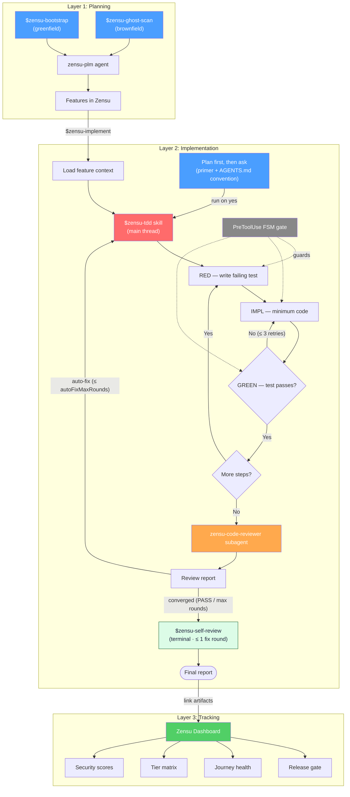

# Zensu for Codex

[](LICENSE)
[](CHANGELOG.md)

**Product Lifecycle Manager — features as first-class citizens, for the [OpenAI Codex CLI](https://developers.openai.com/codex/).**

Zensu treats features as first-class citizens across the entire development
lifecycle — from product planning through disciplined implementation to release
readiness. `zensu-codex` is the Codex port of the
[`zensu-claude-code`](https://github.com/MKITConsulting/zensu-claude-code)
plugin and is **continuously kept in sync with it**: the workflow logic is
preserved verbatim, only the engine-specific edges are adapted, and every
release records what was ported and where this port deliberately differs in the
[CHANGELOG](CHANGELOG.md) (the parity ledger). It installs through Codex's
native plugin system: a `.codex-plugin/plugin.json` manifest, `skills/`,
`agents/` (subagents), `hooks/`, and a `.mcp.json` MCP server.

## Table of contents

- [The three layers](#the-three-layers)
- [Workflow overview](#workflow-overview)
- [Requirements](#requirements)
- [Install](#install)
- [Authentication](#authentication)
- [What you get](#what-you-get)
  - [MCP server](#mcp-server-60-tools)
  - [Skills](#skills-10)
  - [Subagents](#subagents-3)
  - [Lifecycle hooks](#lifecycle-hooks)
- [The TDD engine](#the-tdd-engine)
- [Typical workflows](#typical-workflows)
- [Graceful degradation](#graceful-degradation)
- [Configuration](#configuration-zensuconfigjson)
- [Data & privacy](#data--privacy)
- [Claude Code → Codex mapping & fidelity matrix](#claude-code--codex-mapping--fidelity-matrix)
- [Repository layout](#repository-layout)
- [Platform support](#platform-support)
- [Troubleshooting](#troubleshooting)
- [Uninstall](#uninstall)
- [License](#license)

## The three layers

```
Planning              →  Implementation   →  Tracking
zensu-plm agent          $zensu-tdd          Zensu Dashboard
$zensu-bootstrap         code-reviewer       (Web UI)
$zensu-ghost-scan        auto-fix loop
$zensu-implement         (main thread)
```

**Layer 1 — Planning (WHAT is being built?):** Bootstrap a greenfield product
from a vision document (`$zensu-bootstrap`), or scan an existing codebase to
discover and import undocumented features (`$zensu-ghost-scan`) — or, for a
brownfield repo that *also* ships a forward plan doc, run the **hybrid**:
ghost-scan what is built, then add the plan's not-yet-built items as `planned`
features. All end with features tracked in Zensu with security profiles, user
journeys, and pricing tiers. Each discovered feature is seated at a **v1
build-out baseline** (a revision); features grow from there through deeper
revisions (stages) and subfeatures (parts).

**Layer 2 — Implementation (HOW is it built securely?):** Strict TDD
(Test-Driven Development — write a failing test first, then the minimum
implementation to make it pass, then refactor) enforced by a PreToolUse FSM
(Finite State Machine) gate that blocks edits outside the declared
RED→IMPL→GREEN phase, followed by a five-perspective code-review chain. An
opt-out (`hooks.tddImplementation=false`) runs the same workflow in **vanilla
mode** — implementation without the RED→GREEN ceremony, audits and review chain
still enforced (see [The TDD engine](#the-tdd-engine)).

**Layer 3 — Tracking (HOW is progress tracked?):** Web dashboard for POs and
stakeholders — security scores, tier matrix, journey health, coverage trends.
No terminal required.

## Workflow overview



In vanilla mode (`hooks.tddImplementation=false`) the RED→IMPL→GREEN loop and
the FSM gate drop out of the diagram; everything from the reviewer onward is
unchanged.

## Requirements

- **Codex CLI ≥ 0.130.0** (`codex --version`). Verified against 0.130.0, where
  the `hooks`, `plugins`, and `multi_agent` features are **stable**.
- **Node.js 18+** on PATH (the hook scripts use `node` for JSON parsing).
- **bash** + **git** (POSIX bash; macOS/Linux, or Windows via WSL/Git Bash).

## Install

```bash
# 1. Register the marketplace (GitHub repo, or an absolute path to a local checkout)
codex plugin marketplace add MKITConsulting/zensu-codex

# 2. Install the plugin (interactive picker)
codex /plugins            # select "Zensu" -> Install

# 3. Authenticate the MCP server
codex mcp login zensu     # OAuth (or use an API key, see Authentication)

# 4. Enable + trust the lifecycle hooks (TDD gate, witness, stop-enforcer, banner)
codex --enable plugin_hooks   # plugin_hooks is under development on 0.130.0
codex /hooks                  # review -> Trust the zensu hooks
```

Installing the plugin registers its components straight from
`.codex-plugin/plugin.json`: the 10 skills, the 3 subagents, the `zensu` MCP
server (`.mcp.json`), and the lifecycle hooks (`hooks/hooks.json`). Restart
Codex (or open a new session) afterward.

(Optional) To carry the Zensu conventions even with hooks disabled, append the
plugin's `AGENTS.zensu.md` to `~/.codex/AGENTS.md`.

### Trust the hooks (required, one-time)

Codex does not run any **non-managed** hook until you review and trust it — a
security gate that applies to user, project, AND plugin hooks alike. After
installing, start Codex and run **`/hooks`**: inspect the zensu hook sources and
**Trust** them. Until you do, the TDD phase-gate, the test witness, the Stop
chain-enforcer, and the session banner stay inactive (Codex prints a startup
warning telling you to open `/hooks`). Trust is keyed to each hook's content
hash, so after a plugin update that changes a hook you re-trust it via
`/hooks`. Only enterprise **managed** hooks (`requirements.toml`) skip this
review.

> **Heads-up on hooks (0.130.0):** plugin-bundled hooks execute only when the
> `plugin_hooks` feature is enabled (step 4), and it is still *under
> development* on 0.130.0 — so the TDD phase-gate and the other hooks may not
> fire reliably until it stabilizes. Skills, subagents, and the MCP server do
> **not** depend on it and work today. When plugin hooks do run, Codex injects
> `CLAUDE_PLUGIN_ROOT` into their environment, which the hook scripts use to
> resolve the plugin root. See the fidelity matrix below.

## Authentication

The MCP server at `https://mcp.zensu.dev/mcp` is registered from the plugin's
`.mcp.json` on install.

### OAuth browser login (recommended)

The bundled `.mcp.json` carries no token, so sign in once:

```bash
codex mcp login zensu
```

Tokens are cached and refreshed automatically.

### API key (CI / headless)

For environments without a browser, register a user-level server entry that
reads the key as a bearer token (it takes precedence over the plugin's
token-less entry and survives plugin upgrades):

```bash
export ZENSU_API_KEY=zsk_...
codex mcp add zensu --url https://mcp.zensu.dev/mcp --bearer-token-env-var ZENSU_API_KEY
```

The equivalent `~/.codex/config.toml` block:

```toml
[mcp_servers.zensu]
url = "https://mcp.zensu.dev/mcp"
# bearer_token_env_var = "ZENSU_API_KEY"   # uncomment for CI/key auth
```

### Self-hosting

Point the same user-level entry at your own endpoint instead:

```bash
codex mcp add zensu --url https://mcp.example.internal/mcp
```

## What you get

### MCP server (60 tools)

A single streamable-HTTP server named **`zensu`** exposing ~60 tools (feature
CRUD, subfeatures, linking, security analysis, revisions, lifecycle, tiers,
journeys, bootstrap, product studio, docs context, wiki, knowledge search,
pulse, ghost-scan, workflow). The skills and the `zensu-plm` agent reference
them by their bare verb (`create_feature`, `ghost_scan`, …).

### Skills (10)

Invoke with `$name` (or via the `/skills` menu). Each is a `SKILL.md` with YAML
`name`/`description` frontmatter (Codex's trigger mechanism).

| Skill | Purpose |
|---|---|
| `$zensu-bootstrap` | Greenfield: create product + vision, decompose into components/features, post-bootstrap setup. |
| `$zensu-ghost-scan` | Brownfield: scan a repo for features (multi-lens), apply, discover journeys, seat a v1 baseline. |
| `$zensu-implement` | Implement a tracked feature end-to-end (context → TDD → link artifacts → revision → validate). |
| `$zensu-tdd` | The heart: strict RED→IMPL→GREEN, phase-gated, with a guaranteed review chain — or direct **vanilla** implementation when `hooks.tddImplementation=false`. |
| `$zensu-plan-review` | Pre-implementation gate: a tailored multi-perspective reviewer panel returns GO / REVISE / NO-GO. |
| `$zensu-security-review` | Classify → analyze → suggest+link tests → STRIDE threat model → complete → validate. |
| `$zensu-self-review` | Terminal self-reflection across 7 dimensions; owns the review-chain terminus. |
| `$zensu-reset-review-limit` | Reset the auto-fix round counter and re-arm the review chain. |
| `$zensu-pulse` | Developer journal: start/end a dev session, review activity. |
| `$zensu-help` | Read-only Q&A about Zensu concepts and plugin internals. |

### Subagents (3)

Codex subagents (`agents/*.toml`), spawned explicitly when you ask Codex to use
them.

| Agent | Role |
|---|---|
| `zensu-plm` | Product Lifecycle Manager — orchestrates all `zensu` MCP workflows; scoped to the `zensu` MCP server. |
| `zensu-code-reviewer` | Five-perspective reviewer (conventions, bugs, architecture, tests, security) with build/test verification; runs in fan-out **consume mode** inside the `$zensu-tdd` chain. |
| `zensu-review-aspect` | Single-perspective READ-ONLY reviewer; five run in parallel for the TDD review chain. Runs under an OS-enforced `read-only` sandbox. |

Anti-hallucination rules for both reviewers: every finding requires a
`file:line` reference, confidence ≥ 80, and the file must be Read before
reporting.

### Lifecycle hooks

All hooks read the host's JSON payload on stdin and emit the host's hook output
schema. They are engine-neutral (they resolve the plugin root from
`ZENSU_PLUGIN_ROOT`/`CODEX_PLUGIN_ROOT`/`CLAUDE_PLUGIN_ROOT` or
self-resolution, and the project dir from the payload `cwd`). Each is gated by
`~/.zensu/config.json` (see [Configuration](#configuration-zensuconfigjson)).

| Event (matcher) | Script | What it does |
|---|---|---|
| `SessionStart` | `session-start-pulse.sh` | Writes `~/.zensu/plugin-root`; prints a HEAD/branch readiness line. |
| `SessionStart` | `session-start-capture-sid.sh` | Caches the session id for later hooks. |
| `SessionStart` | `session-start-banner.sh` | User-facing "Zensu PLM active" banner, mode-aware wording (fresh starts only). |
| `SessionStart` | `session-start-primer.sh` | Model-facing orientation (plan → ask about `$zensu-tdd`), mode-aware wording. |
| `PreToolUse` (`apply_patch`/`Edit`/`Write`/`MultiEdit`) | `pre-edit-tdd-reminder.sh` | **The TDD phase-gate** — denies production edits until a failing test exists; denies `.zensu/state/` edits in both modes; passes through for vanilla-mode sessions. |
| `PostToolUse` (`shell`/`Bash`) | `post-bash-witness.sh` | Records every shell command to a witness log (anti-hallucination evidence). |
| `Stop` | `stop-chain-enforcer.sh` | Backstops the review chain (don't end a TDD turn before review completes); mode-aware fix directives. |
| `UserPromptSubmit` | `user-prompt-context-nudge.sh` | Suggests `/compact` when context occupancy crosses a threshold. |

Two upstream hooks have **no Codex event** and ship as reference only (their
behavior moved to `AGENTS.zensu.md`, the session primer, and the skill prose):
`plan-approved-delegate.sh` (plan approval) and `post-review-tdd-delegate.sh`
(subagent-completion auto-fix loop). Upstream hooks not yet ported are listed
in the [fidelity matrix](#claude-code--codex-mapping--fidelity-matrix).

## The TDD engine

`$zensu-tdd` runs strict, one-step-at-a-time RED→GREEN TDD **in the main
thread**, structurally enforced rather than prompt-requested:

- **Phase declaration.** Before any edit, the agent declares the current TDD
  phase via `bash "$(cat ~/.zensu/plugin-root)/hooks/lib/zensu-log.sh" --phase
  <PHASE> --step <step_id>`. Valid phases: `RED_WRITE`, `RED_RUN`, `RED_FAIL`,
  `IMPL`, `GREEN_RUN`, `GREEN_PASS`, `REFACTOR`.
- **Gate enforcement.** The PreToolUse hook blocks edits whose declared phase
  violates FSM transitions — in particular, `IMPL` requires a prior `RED_FAIL`
  marker for the **same step**, so there is no path to production code without
  a failing test on record.
- **State.** Phase markers persist at `.zensu/state/tdd-phase-<session>.json`;
  each step's history is auditable from the file.
- **Activation.** Phase 0 of the skill calls `zensu-log.sh --tdd-begin`, which
  sets a per-session chain-state `active` flag. The gate (and the shell
  witness) enforce **only** while that flag is set — other sessions, other
  subagents, and plain CLI use are never gated. Bypass a single legitimate
  non-TDD edit with `ZENSU_TDD_GATE=off`.

```bash
bash "$(cat ~/.zensu/plugin-root)/hooks/lib/zensu-log.sh" --tdd-begin            # arm the gate + witness (echoes mode: strict|vanilla)
bash "$(cat ~/.zensu/plugin-root)/hooks/lib/zensu-log.sh" --phase RED_WRITE --step 1
# write a failing test, run it…
bash "$(cat ~/.zensu/plugin-root)/hooks/lib/zensu-log.sh" --phase RED_FAIL  --step 1 --reason "asserts X"
bash "$(cat ~/.zensu/plugin-root)/hooks/lib/zensu-log.sh" --phase IMPL      --step 1
# implement until green, then GREEN_RUN / GREEN_PASS, optionally REFACTOR
```

The **phase-gate** reads the per-session FSM state and allows/denies each edit:

| Phase | Test file | Production file |
|---|---|---|
| `RED_WRITE` | allow | allow |
| `RED_FAIL` | allow | **deny** |
| `IMPL` | allow | allow (after a `RED_FAIL` for the step) |
| `GREEN_PASS` | allow | **deny** |
| `REFACTOR` | allow | allow |
| `UNINITIALIZED` | deny | deny |

On Codex the gate parses the freeform `apply_patch` envelope (`*** Update/Add/
Delete File:` lines) — a patch touching several files is denied if **any** file
violates the current phase. While a session is active, edits targeting the
session-state files (`.zensu/state/`) are denied in **both** modes, with
normalized-path classification (dot-segments, case, traversal, symlink and
hard-link aliases all collapse to the same class).

**Vanilla implementation mode.** Setting `hooks.tddImplementation=false`
switches the workflow to vanilla mode — `--tdd-begin` reads the config ONCE,
freezes the mode into the session state (echoing `mode: vanilla`; query later
with `zensu-log.sh --mode`), the gate passes through (the `.zensu/state/` deny
stays), and the RED→GREEN ceremony is dropped while the evidence audits
(build, coverage, witness cross-check) and the review chain stay enforced.
Config flips mid-session change nothing; the ask-before-implementation flows
keep asking, worded "Zensu workflow (vanilla implementation + review chain)".
Beware: a project-local `.zensu/config.json` checked into a repository
pre-selects the mode for every clone (the project file replaces the global
config wholesale — first-match resolution, no merge) — and the same file can
also set `hooks.sessionBanner=false`, silencing the banner signal, which
leaves the `mode:` echo at `--tdd-begin` as the only per-session signal of an
unexpected downgrade.

Additional features: dependency graph for independent-step sequencing, 3-retry
IMPL escalation on GREEN-fail, completeness audit (mtime discipline, build
verification, precondition drift, witness cross-check), real-time progress log
at `.zensu/logs/`.

**Full workflow reference:**
[docs/tdd-manager-workflow.md](plugins/zensu/docs/tdd-manager-workflow.md).
Documentation authoring rules:
[docs/documentation-guide.md](plugins/zensu/docs/documentation-guide.md).

## Typical workflows

### New product (planning → implementation → release)

```
1. $zensu-bootstrap          → Create product, features, journeys, tiers
2. $zensu-implement ZEN-001  → Load context, plan implementation
3. $zensu-tdd                → Strict TDD in the main thread (RED→GREEN per step)
4. zensu-code-reviewer       → 5-perspective review (spawned by $zensu-tdd Phase 6, Stop-hook backstopped)
5. auto-fix loop             → Critical/Important findings fixed in-thread, re-reviewed, capped at autoFixMaxRounds
6. $zensu-security-review    → OWASP, threat model, release gate check
```

### Existing codebase

```
1. $zensu-ghost-scan         → Discover features + journeys + docs (multi-agent fan-out); seat each at a v1 baseline
2. $zensu-security-review    → Assess security posture per feature
3. $zensu-tdd                → Add tests via TDD for untested features
```

### Hybrid (existing codebase + forward plan)

```
1. $zensu-ghost-scan         → Import what is built (each feature seated at a v1 baseline)
2. (zensu-plm) create_feature → Plan doc's not-yet-built items → planned features
3. $zensu-implement ZEN-xxx  → Build the planned items; v1 revision at implement-time
```

### Quick feature (no full TDD)

```
1. $zensu-implement ZEN-042  → Context-aware implementation with artifact linking
2. zensu-code-reviewer       → Quality review (ask Codex to run the subagent)
```

## Graceful degradation

The TDD engine and the code reviewers work **without a Zensu account**. No MCP
connection is needed for:

- TDD orchestration (RED→GREEN cycles, or vanilla mode)
- Code review (five specialist perspectives)
- Progress logging (`.zensu/logs/`)

When the Zensu MCP **is** connected, additional capabilities activate:

- Automatic `link_test` and `link_source_files` after TDD completion
- Feature status updates (`in_progress` → `testing`)
- Revision creation with implementation summary
- Security findings fed into `complete_security_review`
- Release gate validation (`validate_feature_security`)

## Configuration (`~/.zensu/config.json`)

Resolution order (first existing file wins **verbatim** — no merge):
`$ZENSU_CONFIG` → `$CLAUDE_PROJECT_DIR/.zensu/config.json` →
`$HOME/.zensu/config.json`. A missing file or key means "enabled". Copy
[`config.example.json`](plugins/zensu/config.example.json) to start.

> Upstream `zensu-claude-code` deep-merges global + project config per key;
> this port currently uses first-match file replacement (see the fidelity
> matrix). A project-local file therefore replaces your global settings
> wholesale for that project.

| Key | Default | Effect |
|---|---|---|
| `hooks.autoTdd` | `true` | Plan→ask-about-TDD directive (advisory on Codex; see fidelity matrix). |
| `hooks.tddImplementation` | `true` | `false` switches `$zensu-tdd` to **vanilla mode** — no RED→GREEN ceremony or phase markers, the edit gate passes through (`.zensu/state/` edits stay denied), tests at the agent's discretion; evidence audits + review chain stay enforced. Frozen per session at `--tdd-begin` (echoes `mode: …`; details in [The TDD engine](#the-tdd-engine)). |
| `hooks.chainEnforcer` | `true` | Stop-hook review-chain backstop. |
| `hooks.autoFix` | `true` | Auto-fix loop behavior (skill-driven on Codex). |
| `hooks.autoFixIncludeSuggestions` | `false` | Route all severities vs Critical+Important only. |
| `hooks.autoFixMaxRounds` | `5` (1–99) | Review→fix round cap + stop-block budget (`cap+3`). |
| `hooks.combinedSummary` | `true` | Render the narrative chain-end summary. |
| `hooks.selfReview` | `true` | Terminal `$zensu-self-review` stage owns the chain terminus. |
| `hooks.pulseSession` | `true` | SessionStart HEAD/branch banner (plugin-root write is unconditional). |
| `hooks.sessionBanner` | `true` | User banner + model primer on fresh starts. |
| `context.compactionNudge` | `true` | `/compact` nudge on/off. |
| `context.nudgeThreshold` | `50` (1–99) | Occupancy % at which the nudge fires. |
| `context.windowSize` | unset | 100%-denominator token budget (unset → auto-tier 200k/1M). |
| `logging.timestampStyle` | `wall` | `wall` `[HH:MM:SS]` \| `relative` `[+HH:MM:SS]` \| `none`. |

Resolution rules:

- File missing → all hooks active (default, backward compatible).
- Key missing → hook active.
- Only an explicit boolean `false` disables a hook. Flag names are
  **case-sensitive** and must be **JSON booleans**, not strings — a misspelled
  key or a quoted `"false"` is silently treated as enabled.

**Selective opt-out (e.g. silence the banner only):**

```json
{
  "hooks": {
    "sessionBanner": false
  }
}
```

### Log timestamp style

The `$zensu-tdd` workflow writes a session log under
`.zensu/logs/YYYY-MM-DD-HHMM_tdd-<slug>.log` with one line per phase. The
wall-clock prefix on each line can be reformatted or suppressed:

| Style | Inline format | Example |
|---|---|---|
| `wall` (default) | `[HH:MM:SS]` | `[14:23:45] step1 RED test_isOdd — FAIL` |
| `relative` | `[+HH:MM:SS]` from session start; `[+Dd HH:MM:SS]` ≥ 24h | `[+00:01:23] step1 RED test_isOdd — FAIL` |
| `none` | no prefix | `step1 RED test_isOdd — FAIL` |

Invalid values, missing keys, malformed JSON, or a missing `node` binary all
fall back to `wall`.

### Environment variables

| Variable | Description |
|---|---|
| `ZENSU_API_KEY` | API key for headless/CI auth — wire it via `codex mcp add … --bearer-token-env-var` (see [Authentication](#authentication)). |
| `ZENSU_CONFIG` | Absolute path to an alternative config file (first in the resolution order). |
| `ZENSU_TDD_GATE` | Set to `off` to bypass the TDD phase-gate for a legitimate non-TDD edit. |
| `ZENSU_TEST_WITNESS` | Set to `off` to disable the shell-command witness for the session. |
| `ZENSU_CHAIN` | Set to `off` to disable the Stop-hook review-chain backstop (shell-scoped equivalent of `hooks.chainEnforcer:false`). |
| `ZENSU_PLUGIN_ROOT` / `CODEX_PLUGIN_ROOT` | Override plugin-root resolution for the hook scripts (normally injected by the host). |
| `CLAUDE_PLUGIN_DATA_OVERRIDE` | Relocate the auto-fix rounds counter (default: `${CLAUDE_PROJECT_DIR:-.}/.zensu/state/rounds-<sid>.json`). |

## Data & privacy

When the MCP server is connected, certain data is transmitted to it.

**What is transmitted:** product names, feature titles and descriptions,
security classifications and OWASP tags, file paths (not file contents), git
SHAs and branch names, vision documents (may contain product strategy), pulse
session metadata (tool names, durations, feature IDs, file paths).

**Where it goes:** `https://mcp.zensu.dev` by default (HTTPS), or your
self-hosted endpoint (see [Authentication](#authentication)).

**What is NOT transmitted:** source code content, file contents (only paths),
error messages (unless free-text logging is explicitly enabled for Pulse).

**Data retention:** pulse sessions 90 days by default (configurable).

If you operate under GDPR, CCPA, or similar regulations, review the list above
and consider a self-hosted instance for full data control. The TDD/review
engine itself transmits nothing (see
[Graceful degradation](#graceful-degradation)).

## Claude Code → Codex mapping & fidelity matrix

Codex's plugin model is a close structural mirror of Claude Code's, so most of
the plugin ports cleanly. The honest gaps are around two hook events Codex does
not expose and a few payload/tool-name differences (already adapted in the
hooks).

| Capability | Claude Code | Codex (this port) | Fidelity on 0.130.0 |
|---|---|---|---|
| Plugin manifest | `.claude-plugin/plugin.json` | `.codex-plugin/plugin.json` | **full** |
| MCP server | `.mcp.json` (`type:http`) | `.mcp.json` (`url`) + `codex mcp add` | **full** |
| Skills / slash commands | `skills/*/SKILL.md`, `/zensu:x` | `skills/*/SKILL.md` (+ YAML frontmatter), `$zensu-x` | **full** (frontmatter added; invocation `$name`) |
| Subagents | `agents/*.md`, auto-delegated | `agents/*.toml`, **explicit spawn** | **partial** — no proactive auto-delegation |
| Persistent instructions | `CLAUDE.md` + SessionStart primer | `AGENTS.md` (global block) + primer | **full** |
| `SessionStart` hooks | banner/primer/pulse/sid | same (Codex `SessionStart`, `source` field present) | **full** |
| `PreToolUse` TDD gate | `Edit\|Write\|MultiEdit` + `file_path`, deny | `apply_patch` (parse patch) + Edit/Write, **deny** | **full** — deny schema identical |
| `PostToolUse` witness | `Bash` tool | `shell` tool (argv array normalized) | **full** |
| `UserPromptSubmit` nudge | reads Claude transcript usage | wired; parser is Claude-transcript-shaped | **partial** — likely inert until adapted to Codex rollout format |
| `Stop` review backstop | `{decision:block}` re-prompts | same block + mode-aware fix wording (Codex-local; see CHANGELOG 0.2.0); Codex Stop can't hard-block | **partial → advisory** |
| Plan-approval → ask TDD | `PostToolUse` `ExitPlanMode` hook | **no event** → `AGENTS.md` + primer convention | **gap → advisory** |
| Auto-fix loop | `PostToolUse` `Agent` completion hook | **no event** → `$zensu-tdd` skill prose + Stop backstop | **gap → skill-driven** |
| Review chain (5 aspects) | parallel subagent fan-out | `zensu-review-aspect` subagents (explicit spawn) | **partial** — parallel, but explicitly requested |
| Per-turn TDD reminder | `user-prompt-tdd-reminder.sh` | **not yet ported** (upstream #107; recorded in CHANGELOG) | **gap** |
| MCP write-gate | `pre-mcp-zensu-gate.sh` + skill workflow windows | **not yet ported** | **gap** |
| Config resolution | deep-merge global + project per key | first-match file replacement | **divergent** — see Configuration |
| State machine / logging / config libs | `hooks/lib/*` | ported + local hardening (CHANGELOG 0.2.0 Changed/Fixed) | **full** |
| Marketplace / install | `claude plugin marketplace` | `codex plugin marketplace add` + `codex /plugins` | **full** for skills/MCP/agents; hooks need `plugin_hooks` (under-dev) + `/hooks` trust |

**Bottom line.** The crown-jewel TDD phase-gate transplants at **full
fidelity** (Codex's `PreToolUse` deny is equivalent to Claude's). The plugin's
structural *guarantees* that depend on events Codex lacks — the un-skippable
Stop backstop and the auto-firing review loop — degrade from hook-enforced
invariants to strongly-instructed conventions (carried by `AGENTS.zensu.md`,
the session primer, and the skill prose). One place Codex is actually
*stronger*: the `zensu-review-aspect` subagent runs under an OS-enforced
`read-only` sandbox, where Claude relies on prose alone.

## Repository layout

The repo is a Codex plugin **marketplace**; the plugin itself lives in a
subdirectory (the layout Codex expects — `marketplace.json` points at it).

```
zensu-codex/                             # repo = a Codex plugin marketplace
├── .agents/plugins/marketplace.json     # marketplace descriptor → source ./plugins/zensu
├── README.md  CHANGELOG.md  LICENSE     # repo docs
├── AGENTS.md                            # repo guide (for working in this repo)
├── reference/                           # original Claude Code agent defs (port source of truth)
├── tests/smoke.sh                       # offline checks (packaging, hook syntax, gate behavior)
└── plugins/zensu/                       # ← the plugin root (.codex-plugin/plugin.json)
    ├── .codex-plugin/plugin.json        # Codex plugin manifest
    ├── .mcp.json                        # the zensu HTTP MCP server
    ├── AGENTS.zensu.md                  # optional conventions block to append to ~/.codex/AGENTS.md
    ├── config.example.json              # ~/.zensu/config.json template
    ├── agents/                          # 3 subagents: zensu-plm, zensu-code-reviewer, zensu-review-aspect
    ├── skills/                          # 10 skills (SKILL.md w/ frontmatter)
    ├── hooks/                           # hooks.json + *.sh + lib/ (config, session, tdd-phase, log, runtime)
    └── docs/                            # tdd-manager-workflow.md, documentation-guide.md
```

## Platform support

Hooks require a POSIX-compatible shell. Supported platforms:

- macOS
- Linux
- Windows via WSL or Git Bash (native `cmd.exe`/PowerShell are not supported for hooks)

## Troubleshooting

| Problem | Solution |
|---|---|
| MCP server unreachable | Verify network connectivity to `https://mcp.zensu.dev/mcp` (or your self-hosted URL). |
| Invalid API key | Verify the `ZENSU_API_KEY` format (`zsk_...`) and that the bearer-token MCP entry is registered — see [Authentication](#authentication). |
| Hooks never fire | Enable the feature (`codex --enable plugin_hooks`) AND trust the hooks via `/hooks` — both are required; see [Install](#install). |
| Hook errors on Windows | Use WSL or Git Bash (see [Platform support](#platform-support)). |
| OAuth login not opening | Check your default browser settings; fall back to the API-key path. |
| TDD phase gate blocking a legitimate edit | Set `ZENSU_TDD_GATE=off` for that edit only, or declare the correct phase via `zensu-log.sh --phase <PHASE> --step <id>` first. |
| Review chain refuses to end the turn | The Stop backstop is armed (`implComplete` without `chainDone`) — finish the review chain, or grant a new budget with `$zensu-reset-review-limit`, or set `ZENSU_CHAIN=off`. |

## Uninstall

```bash
codex plugin marketplace remove zensu   # or uninstall via  codex /plugins
codex mcp remove zensu                  # drop the MCP server (if added separately)
codex /hooks                            # untrust the zensu hooks (optional)
```

This removes the plugin's skills, subagents, hooks, and MCP server. It leaves
`~/.zensu/config.json` and any project `.zensu/` artifacts in place. If you
appended `AGENTS.zensu.md` to `~/.codex/AGENTS.md`, remove that block by hand.
Restart Codex.

## License

**Functional Source License, Version 1.1, Apache 2.0 Future License**
([FSL-1.1-Apache-2.0](LICENSE)) — mirrors the upstream `zensu-claude-code`
license.

- **You can use it for any Permitted Purpose** — internal use, modifications,
  forks, commercial projects, professional services for clients, education,
  research.
- **You cannot use it for a Competing Use** — you may not offer a commercial
  product or service that substitutes for the Zensu plugin or the Zensu SaaS
  while this restriction is in effect.
- **Auto-conversion to Apache 2.0** — each release converts to the Apache
  License 2.0 on the second anniversary of its public availability.

The full text and the canonical FAQ live at
[fsl.software](https://fsl.software/). For commercial-use questions outside the
Permitted Purpose, contact [contact@zensu.dev](mailto:contact@zensu.dev).
