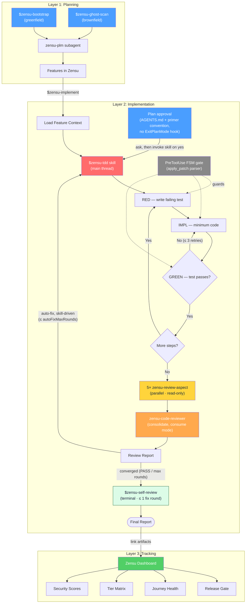

# Zensu for Codex

**Product Lifecycle Manager — features as first-class citizens, for the [OpenAI Codex CLI](https://developers.openai.com/codex/).**

`zensu-codex` is a faithful port of the [`zensu-claude-code`](https://github.com/MKITConsulting/zensu-claude-code) plugin (v0.8.0) to Codex's native plugin system. It packages the same behavior — feature tracking, strict RED→GREEN TDD with a phase-gated edit guard, a five-perspective code-review chain, security reviews, release-readiness gating, and greenfield/brownfield onboarding — as a Codex plugin: a `.codex-plugin/plugin.json` manifest, `skills/`, `agents/` (subagents), `hooks/`, and a `.mcp.json` MCP server, installed through Codex's native plugin system.

> **Status:** local plugin, not yet published to a remote marketplace. Install from this checkout with `codex plugin marketplace add` (see below).

---

## Table of contents
- [What is Zensu?](#what-is-zensu)
- [Agent & workflow overview](#agent--workflow-overview)
- [Requirements](#requirements)
- [Install](#install)
- [Authentication](#authentication)
- [What you get](#what-you-get)
  - [MCP server](#mcp-server)
  - [Skills](#skills)
  - [Subagents](#subagents)
  - [Lifecycle hooks](#lifecycle-hooks)
- [The TDD engine](#the-tdd-engine)
- [Configuration](#configuration-zensuconfigjson)
- [Claude Code → Codex mapping & fidelity matrix](#claude-code--codex-mapping--fidelity-matrix)
- [Repository layout](#repository-layout)
- [Uninstall](#uninstall)
- [How the port was built](#how-the-port-was-built)
- [License](#license)

---

## What is Zensu?

Zensu is a SaaS Product Lifecycle Manager (PLM) that treats **features as
first-class citizens** across the entire software lifecycle — from roadmap to
release. The CLI plugin is the in-terminal front door to that SaaS, plus a
stack-agnostic TDD/review discipline engine that works even with no account.

Core model:
- **Organizations → Products.** A product owns **Components** (domain modules),
  **Tiers** (pricing levels with feature gating), **Features**, and **User Journeys**.
- **Features** carry `ZEN-XXX` IDs (e.g. `ZEN-001`), referenced in commits as
  `[ZEN-001]`. Status lifecycle: `planned → in-progress → testing → released`,
  gated by a **security score** (0–10), **docs completeness**, and **journey health**.
- Per-feature build-out runs along two axes: **revisions** (`create_revision`,
  v1/v2…, stages over time) and **subfeatures** (`add_subfeature`, structural parts).

Three layers of behavior:
1. **Planning (what):** the `zensu-plm` agent + `$zensu-bootstrap` (greenfield) /
   `$zensu-ghost-scan` (brownfield) / hybrid.
2. **Implementation (how, securely):** `$zensu-tdd` — strict RED→GREEN TDD,
   enforced by a PreToolUse phase-gate, followed by a five-perspective review chain.
3. **Tracking (progress):** a web dashboard (outside this repo) fed by the MCP server.

---

## Agent & workflow overview

The same three-layer flow as the upstream Claude Code plugin, with the Codex
specifics baked in: skills are invoked as `$zensu-x`, the plan-approval ask is
an `AGENTS.md` + primer convention (Codex has no `ExitPlanMode` hook event), the
review chain fans out five explicitly-spawned `zensu-review-aspect` subagents
before consolidating through `zensu-code-reviewer`, and the auto-fix loop is
skill-driven (backstopped by the advisory Stop hook).



---

## Requirements

- **Codex CLI ≥ 0.130.0** (`codex --version`). Verified against 0.130.0, where
  the `hooks`, `plugins`, and `multi_agent` features are **stable**.
- **Node.js** (Codex bundles a Node launcher; the hook scripts use `node` for
  JSON parsing — Node 18+ on PATH is sufficient).
- **bash** + **git** (the hooks and installer are POSIX bash; macOS/Linux, or
  Windows via WSL/Git Bash).

---

## Install

```bash
# 1. Register the marketplace (a local dir now; owner/repo once pushed to GitHub)
codex plugin marketplace add /absolute/path/to/zensu-codex

# 2. Install the plugin (interactive picker)
codex /plugins            # select "Zensu" -> Install

# 3. Authenticate the MCP server
codex mcp login zensu     # OAuth (or set ZENSU_API_KEY for a bearer token, see Authentication)

# 4. Enable + trust the lifecycle hooks (TDD gate, witness, stop-enforcer, banner)
codex --enable plugin_hooks   # plugin_hooks is under development on 0.130.0
codex /hooks                  # review -> Trust the zensu hooks
```

Installing the plugin registers its components straight from
`.codex-plugin/plugin.json`: the 10 skills, the 3 subagents, the `zensu` MCP
server (`.mcp.json`), and the lifecycle hooks (`hooks/hooks.json`). Restart Codex
(or open a new session) afterward.

(Optional) To carry the Zensu conventions even with hooks disabled, append this
repo's `AGENTS.zensu.md` to `~/.codex/AGENTS.md`.

### Trust the hooks (required, one-time)

Codex does not run any **non-managed** hook until you review and trust it — a
security gate that applies to user, project, AND plugin hooks alike. After
installing, start Codex and run **`/hooks`**: inspect the zensu hook sources and
**Trust** them. Until you do, the TDD phase-gate, the test witness, the Stop
chain-enforcer, and the session banner stay inactive (Codex prints a startup
warning telling you to open `/hooks`). Trust is keyed to each hook's content hash,
so after a plugin update that changes a hook you re-trust it via `/hooks`. Only
enterprise **managed** hooks (`requirements.toml`) skip this review.

> **Heads-up on hooks (0.130.0):** plugin-bundled hooks execute only when the
> `plugin_hooks` feature is enabled (step 4), and it is still *under development*
> on 0.130.0 (verified via `codex features list` + openai/codex PR #19705) — so
> the TDD phase-gate and the other hooks may not fire reliably until it stabilizes.
> Skills, subagents, and the MCP server do **not** depend on it and work today.
> When plugin hooks do run, Codex injects `CLAUDE_PLUGIN_ROOT` into their
> environment, which the hook scripts use to resolve the plugin root. See the
> fidelity matrix below.

---

## Authentication

The MCP server at `https://mcp.zensu.dev/mcp` is registered from the plugin's
`.mcp.json` on install. Two auth paths:

- **OAuth (default, interactive):** the bundled `.mcp.json` carries no token, so
  sign in once with
  ```bash
  codex mcp login zensu
  ```
- **API key (CI / headless):** register a user-level server entry that reads the
  key as a bearer token (takes precedence over the plugin's token-less entry):
  ```bash
  export ZENSU_API_KEY=zsk_...
  codex mcp add zensu --url https://mcp.zensu.dev/mcp --bearer-token-env-var ZENSU_API_KEY
  ```
- **Self-hosting:** point at your own endpoint:
  ```bash
  codex mcp add zensu --url https://mcp.example.internal/mcp
  ```

The equivalent `~/.codex/config.toml` block:
```toml
[mcp_servers.zensu]
url = "https://mcp.zensu.dev/mcp"
# bearer_token_env_var = "ZENSU_API_KEY"   # uncomment for CI/key auth
```

> **Graceful degradation:** the TDD engine, code review, and progress logging
> work with **no Zensu account / no MCP connection**. The MCP tools only augment
> the flow (auto-link tests/sources, status updates, revisions, release gating).

---

## What you get

### MCP server

A single streamable-HTTP server named **`zensu`** exposing ~60 tools (feature
CRUD, subfeatures, linking, security, revisions, lifecycle, tiers, journeys,
bootstrap, product studio, docs context, wiki, knowledge search, pulse,
ghost-scan, workflow). Codex surfaces them as `zensu` tools; the skills and the
`zensu-plm` agent reference them by their bare verb (`create_feature`,
`ghost_scan`, …).

### Skills

Invoke with `$name` (or via the `/skills` menu). Each is a `SKILL.md` with YAML
`name`/`description` frontmatter (Codex's trigger mechanism).

| Skill | Purpose |
|---|---|
| `$zensu-bootstrap` | Greenfield: create product + vision, decompose into components/features, post-bootstrap setup. |
| `$zensu-ghost-scan` | Brownfield: scan a repo for features (multi-lens), apply, discover journeys, seat a v1 baseline. |
| `$zensu-implement` | Implement a tracked feature end-to-end (context → TDD → link artifacts → revision → validate). |
| `$zensu-tdd` | The heart: strict RED→IMPL→GREEN, phase-gated, with a guaranteed review chain. |
| `$zensu-plan-review` | Pre-implementation gate: a tailored multi-perspective reviewer panel returns GO / REVISE / NO-GO. |
| `$zensu-security-review` | Classify → analyze → suggest+link tests → STRIDE threat model → complete → validate. |
| `$zensu-self-review` | Terminal self-reflection across 7 dimensions; owns the review-chain terminus. |
| `$zensu-reset-review-limit` | Reset the auto-fix round counter and re-arm the review chain. |
| `$zensu-pulse` | Developer journal: start/end a dev session, review activity. |
| `$zensu-help` | Read-only Q&A about Zensu concepts and workflows. |

### Subagents

Codex subagents (`agents/*.toml`), spawned explicitly when you ask Codex to use them.

| Agent | Role |
|---|---|
| `zensu-plm` | Product Lifecycle Manager — orchestrates all `zensu` MCP workflows; scoped to the `zensu` MCP server. |
| `zensu-code-reviewer` | Five-perspective reviewer (conventions, bugs, architecture, tests, security) with build/test verification. |
| `zensu-review-aspect` | Single-perspective reviewer; five run in parallel for the TDD review chain. Runs `read-only` sandboxed. |

### Lifecycle hooks

All hooks read the host's JSON payload on stdin and emit the host's hook output
schema. They are engine-neutral (they resolve the plugin root from
`ZENSU_PLUGIN_ROOT`/`CODEX_PLUGIN_ROOT`/`CLAUDE_PLUGIN_ROOT` or self-resolution,
and the project dir from the payload `cwd`). Each is gated by `~/.zensu/config.json`.

| Event (matcher) | Script | What it does |
|---|---|---|
| `SessionStart` | `session-start-pulse.sh` | Writes `~/.zensu/plugin-root`; prints a HEAD/branch readiness line. |
| `SessionStart` | `session-start-capture-sid.sh` | Caches the session id for later hooks. |
| `SessionStart` | `session-start-banner.sh` | User-facing "Zensu PLM active" banner (fresh starts only). |
| `SessionStart` | `session-start-primer.sh` | Model-facing orientation (plan → ask about `$zensu-tdd`). |
| `PreToolUse` (`apply_patch`/`Edit`/`Write`/`MultiEdit`) | `pre-edit-tdd-reminder.sh` | **The TDD phase-gate** — denies production edits until a failing test exists. |
| `PostToolUse` (`shell`/`Bash`) | `post-bash-witness.sh` | Records every shell command to a witness log (anti-hallucination evidence). |
| `Stop` | `stop-chain-enforcer.sh` | Backstops the review chain (don't end a TDD turn before review completes). |
| `UserPromptSubmit` | `user-prompt-context-nudge.sh` | Suggests `/compact` when context occupancy crosses a threshold. |

Two upstream hooks have **no Codex event** and are kept as reference only (their
behavior moved to `AGENTS.md` + skill prose): `plan-approved-delegate.sh`
(ExitPlanMode) and `post-review-tdd-delegate.sh` (subagent-completion auto-fix loop).

---

## The TDD engine

`$zensu-tdd` runs strict, one-step-at-a-time RED→GREEN TDD. Each step declares
its phase through the helper:

```bash
bash "$(cat ~/.zensu/plugin-root)/hooks/lib/zensu-log.sh" --tdd-begin            # arm the gate + witness
bash "$(cat ~/.zensu/plugin-root)/hooks/lib/zensu-log.sh" --phase RED_WRITE --step 1
# write a failing test, run it…
bash "$(cat ~/.zensu/plugin-root)/hooks/lib/zensu-log.sh" --phase RED_FAIL  --step 1 --reason "asserts X"
bash "$(cat ~/.zensu/plugin-root)/hooks/lib/zensu-log.sh" --phase IMPL      --step 1
# implement until green, then GREEN_RUN / GREEN_PASS, optionally REFACTOR
```

The **phase-gate** (`pre-edit-tdd-reminder.sh`) reads the per-session FSM state
and allows/denies each edit:

| Phase | Test file | Production file |
|---|---|---|
| `RED_WRITE` | allow | allow |
| `RED_FAIL` | allow | **deny** |
| `IMPL` | allow (after a `RED_FAIL` for the step) | allow (after `RED_FAIL`) |
| `GREEN_PASS` | allow | **deny** |
| `REFACTOR` | allow | allow |
| `UNINITIALIZED` | deny | deny |

On Codex the gate parses the freeform `apply_patch` envelope (`*** Update/Add/
Delete File:` lines) — a patch touching several files is denied if **any** file
violates the current phase. Full docs: [`docs/tdd-manager-workflow.md`](docs/tdd-manager-workflow.md).
Documentation authoring rules: [`docs/documentation-guide.md`](docs/documentation-guide.md).

---

## Configuration (`~/.zensu/config.json`)

Resolution order (first match **replaces**, no merge): `$ZENSU_CONFIG` →
`$CLAUDE_PROJECT_DIR/.zensu/config.json` → `$HOME/.zensu/config.json`. A missing
file or key means "enabled". Copy `config.example.json` to start.

| Key | Default | Effect |
|---|---|---|
| `hooks.autoTdd` | `true` | Plan→ask-about-TDD directive (advisory on Codex; see fidelity matrix). |
| `hooks.chainEnforcer` | `true` | Stop-hook review-chain backstop. |
| `hooks.autoFix` | `true` | Auto-fix loop behavior (skill-driven on Codex). |
| `hooks.autoFixIncludeSuggestions` | `false` | Route all severities vs Critical+Important only. |
| `hooks.autoFixMaxRounds` | `5` (1–99) | Review→fix round cap + stop-block budget (`cap+3`). |
| `hooks.combinedSummary` | `true` | Render the 3-section chain-end summary. |
| `hooks.selfReview` | `true` | Terminal `$zensu-self-review` stage owns the chain terminus. |
| `hooks.pulseSession` | `true` | SessionStart HEAD/branch banner (plugin-root write is unconditional). |
| `hooks.sessionBanner` | `true` | User banner + model primer on fresh starts. |
| `context.compactionNudge` | `true` | `/compact` nudge on/off. |
| `context.nudgeThreshold` | `50` (1–99) | Occupancy % at which the nudge fires. |
| `context.windowSize` | unset | 100%-denominator token budget (unset → auto-tier 200k/1M). |
| `logging.timestampStyle` | `wall` | `wall` `[HH:MM:SS]` \| `relative` `[+HH:MM:SS]` \| `none`. |

**Environment overrides:** `ZENSU_CONFIG` (config path), `ZENSU_TDD_GATE=off`
(disable the phase-gate), `ZENSU_TEST_WITNESS=off`, `ZENSU_CHAIN=off` (disable
the Stop backstop), `ZENSU_MCP_URL` (self-host URL, installer-only),
`ZENSU_PLUGIN_ROOT`/`CODEX_PLUGIN_ROOT` (override plugin-root resolution).

---

## Claude Code → Codex mapping & fidelity matrix

Codex's plugin model is a close structural mirror of Claude Code's, so most of
the plugin ports cleanly. The honest gaps are around two hook events Codex does
not expose and a few payload/tool-name differences (already adapted in the hooks).

| Capability | Claude Code | Codex (this port) | Fidelity on 0.130.0 |
|---|---|---|---|
| Plugin manifest | `.claude-plugin/plugin.json` | `.codex-plugin/plugin.json` | **full** |
| MCP server | `.mcp.json` (`type:http`) | `.mcp.json` (`url`) + `codex mcp add` | **full** |
| Skills / slash commands | `skills/*/SKILL.md`, `/zensu:x` | `skills/*/SKILL.md` (+ YAML frontmatter), `$zensu-x` | **full** (frontmatter added; invocation `$name`) |
| Subagents | `agents/*.md`, auto-delegated | `agents/*.toml`, **explicit spawn** | **partial** — no proactive auto-delegation |
| Persistent instructions | `CLAUDE.md` + SessionStart primer | `AGENTS.md` (global block) + primer | **full** |
| `SessionStart` hooks | banner/primer/pulse/sid | same (Codex `SessionStart`, `source` field present) | **full** |
| `PreToolUse` TDD gate | `Edit\|Write\|MultiEdit` + `file_path`, deny | `apply_patch` (parse patch) + Edit/Write, **deny** | **full** — deny schema identical |
| `PostToolUse` witness | `Bash` tool | `shell` tool (argv array normalized) | **full** |
| `UserPromptSubmit` nudge | reads Claude transcript usage | wired; parser is Claude-transcript-shaped | **partial** — likely inert until adapted to Codex rollout format |
| `Stop` review backstop | `{decision:block}` re-prompts | emits the same; Codex Stop can't hard-block | **partial → advisory** |
| Plan-approval → ask TDD | `PostToolUse` `ExitPlanMode` hook | **no event** → `AGENTS.md` + primer convention | **gap → advisory** |
| Auto-fix loop | `PostToolUse` `Agent` completion hook | **no event** → `$zensu-tdd` skill prose + Stop backstop | **gap → skill-driven** |
| Review chain (5 aspects) | parallel subagent fan-out | `zensu-review-aspect` subagents (explicit spawn) | **partial** — parallel, but explicitly requested |
| State machine / logging / config | `hooks/lib/*` | **ported verbatim** | **full** |
| Marketplace / install | `claude plugin marketplace` | `codex plugin marketplace add` + `codex /plugins` | **full** for skills/MCP/agents; hooks need `plugin_hooks` (under-dev) + `/hooks` trust |

**Bottom line.** The crown-jewel TDD phase-gate transplants at **full fidelity**
(Codex's `PreToolUse` deny is equivalent to Claude's). The plugin's structural
*guarantees* that depend on events Codex lacks — the un-skippable Stop backstop
and the auto-firing review loop — degrade from hook-enforced invariants to
strongly-instructed conventions (carried by `AGENTS.md` and the skill prose). One
place Codex is actually *stronger*: the `zensu-review-aspect` subagent runs under
an OS-enforced `read-only` sandbox, where Claude relied on prose alone.

---

## Repository layout

The repo is a Codex plugin **marketplace**; the plugin itself lives in a
subdirectory (the layout Codex expects — `marketplace.json` points at it).

```
zensu-codex/                             # repo = a Codex plugin marketplace
├── .agents/plugins/marketplace.json     # marketplace descriptor → source ./plugins/zensu
├── README.md  CHANGELOG.md  LICENSE     # repo docs
├── AGENTS.md                            # repo guide (for working in this repo)
├── reference/                           # original Claude Code agent defs (port source of truth)
├── tests/smoke.sh                       # offline checks
└── plugins/zensu/                       # ← the plugin root (.codex-plugin/plugin.json)
    ├── .codex-plugin/plugin.json        # Codex plugin manifest
    ├── .mcp.json                        # the zensu HTTP MCP server
    ├── AGENTS.zensu.md                  # optional conventions block to append to ~/.codex/AGENTS.md
    ├── config.example.json              # ~/.zensu/config.json template
    ├── agents/                          # 3 subagents: zensu-plm, zensu-code-reviewer, zensu-review-aspect
    ├── skills/                          # 10 skills (SKILL.md w/ frontmatter)
    │   ├── bootstrap/  ghost-scan/  implement/  tdd/  plan-review/
    │   └── security-review/  self-review/  reset-review-limit/  pulse/  zensu-help/
    ├── hooks/                           # hooks.json + *.sh + lib/ (config, session, tdd-phase, log, runtime)
    └── docs/                            # tdd-manager-workflow.md, documentation-guide.md
```

---

## Uninstall

```bash
codex plugin marketplace remove zensu   # or uninstall via  codex /plugins
codex mcp remove zensu                  # drop the MCP server (if added separately)
codex /hooks                            # untrust the zensu hooks (optional)
```

This removes the plugin's skills, subagents, hooks, and MCP server. It leaves
`~/.zensu/config.json` and any project `.zensu/` artifacts in place. If you
appended `AGENTS.zensu.md` to `~/.codex/AGENTS.md`, remove that block by hand.
Restart Codex.

---

## How the port was built

The upstream `zensu-claude-code` plugin was analyzed in depth (manifest, MCP
wiring, 3 agents, 10 skills, 10 hooks + shared libs, config schema, docs, and
tests), and the installed Codex CLI (0.130.0) was probed for its actual plugin /
hook / subagent / MCP support (the `features` flags and the native binary's
embedded schema) before designing the mapping above. Skills, agents, and the hook
state-machine are ported with their workflow logic preserved verbatim; only the
engine-specific edges (tool names, payload fields, plugin-root/project-dir
resolution, the `apply_patch` gate) were adapted.

---

## License

[FSL-1.1-Apache-2.0](LICENSE) — Functional Source License, Apache 2.0 Future
License. Mirrors the upstream `zensu-claude-code` license.
