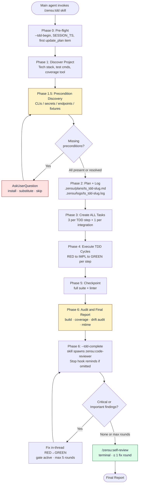
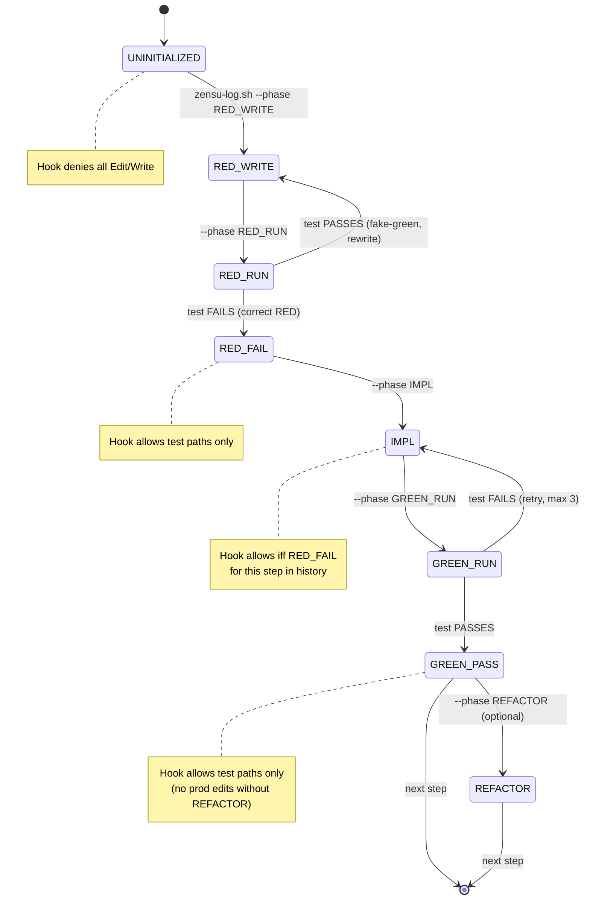
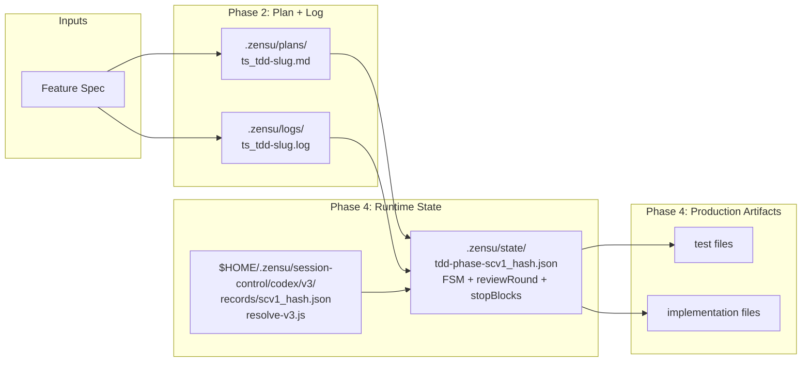
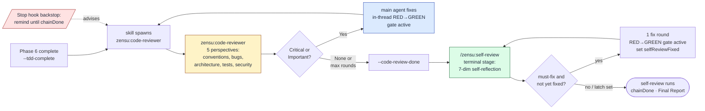

# TDD Workflow (`/zensu:tdd`)

End-to-end reference for the Zensu main-thread TDD workflow that drives strict Red/Green TDD with a PreToolUse phase gate.

> **Notation.** This doc uses `/zensu:x` slash-command notation; on Codex map `/zensu:x` → `$zensu-x`, `zensu:code-reviewer` / `zensu:review-aspect` → the `zensu-code-reviewer` / `zensu-review-aspect` subagents, and the `Edit`/`Write`/`MultiEdit` edit tools ↔ the Codex `apply_patch` envelope (see README, The TDD engine).

> **0.4.0 migration.** TDD execution moved from the `zensu:tdd-manager` *subagent* into the **main agent** (the subagent lost too much implementation context). The workflow now lives in the `skills/tdd/SKILL.md` skill. Reviewers are packet-only subagents; every non-reviewer subagent remains neutral and cannot acquire main-thread control capabilities.

---

## 1. Overview

**What it is.** A main-thread skill (`/zensu:tdd`) that takes a feature specification and produces working, tested code through a strict TDD discipline. The main agent runs it directly. It writes a plan, declares phase transitions (RED → IMPL → GREEN → REFACTOR), and is enforced by a PreToolUse hook that blocks edits which violate the cycle. Vanilla implementation mode is the DEFAULT (strict is opt-in via `hooks.tddImplementation=true`): in vanilla the RED→GREEN discipline and the edit gate are off while the evidence audits and the review chain stay enforced (see §5).

**When to invoke.**

```
Use the Skill tool with skill='zensu:tdd' and the feature spec as input
```

Codex has no plan-approval event. Its trusted primer and `AGENTS.md` convention
ask before implementation; `/zensu:implement` also invokes the skill in Step 3.

**Inputs.**

- A feature specification (free-form text, or a path to `evals/.../prompts/*.md` in eval context).
- Project context — the agent discovers tech stack, test commands, coverage tooling automatically.

**Outputs.**

| Artifact | Path | Purpose |
|----------|------|---------|
| Plan | `.zensu/plans/{ts}_tdd-{slug}.md` | Design decisions, step table, preconditions, audit checklist |
| Log | `<Session-Control project_root>/.zensu/logs/{ts}_tdd-{slug}.log` | Append-only execution trace, phase markers, attempts, audit results |
| State | `.zensu/state/tdd-phase-{session}.json` | Runtime FSM state (per session, ephemeral) |
| Source | test + implementation files | The actual code |
| Audit | included in log + final report | Build, coverage, mtime discipline, precondition drift |

Plan, log, state, and witness files are session-local runtime artifacts under
`.zensu/`. They are gitignored and never staged or committed.

---

## 2. Two-Level Mental Model

Two distinct phase concepts share the word "phase". Keep them separate.

**Workflow Phases (0-6)** — the agent's overall journey for a single task. Linear, one-shot per invocation.

**TDD-FSM phases** — per-step state that the PreToolUse hook reads from the state file. Cyclical, repeated for each step inside Phase 4.

Each step inside Workflow Phase 4 cycles the TDD-FSM through `RED_WRITE → RED_RUN → RED_FAIL → IMPL → GREEN_RUN → GREEN_PASS` (and optionally `REFACTOR`). When all steps complete, the agent advances to Workflow Phase 5.

---

## 3. High-Level Workflow



**Phases at a glance:**

| Phase | Goal | Key outputs |
|-------|------|-------------|
| 0. Pre-flight | Capture `SESSION_TS` + `SESSION_EPOCH`, create first plan item | session timestamps |
| 1. Discover Project | Read the applicable `AGENTS.md` hierarchy, detect tech stack, test runners, coverage tool + threshold | tech-stack context |
| 1.5. Precondition Discovery | Enumerate every external CLI/secret/endpoint/fixture named by the spec, verify presence, escalate misses | Preconditions table in plan |
| 2. Plan + Log | Write plan markdown + initialize log file | plan + log on disk |
| 3. Create ALL Tasks | 3 plan items per TDD step (test/impl/verify) + 1 per integration step | `update_plan` populated |
| 4. Execute TDD Cycles | Per step: RED → IMPL → GREEN (+ REFACTOR if applicable) | source code + tests |
| 5. Checkpoint | Run full test suite + linter, batch-update plan statuses | checkpoint log entry |
| 6. Audit & Final Report | Build verification, coverage, mtime discipline, precondition drift audit, summary | audit log + final report |

See the packaged [`$zensu-tdd` skill](../skills/tdd/SKILL.md) for the canonical phase definitions.

---

## 4. Per-Step TDD-FSM

Inside Phase 4, each step cycles through a small state machine. The PreToolUse hook ([hooks/pre-edit-tdd-reminder.sh](../hooks/pre-edit-tdd-reminder.sh)) reads the current phase from the state file and allows or denies Edit/Write/MultiEdit tool calls based on it.



Phase transitions are recorded by invoking the log helper:

```bash
export ZENSU_SESSION_KEY='<exact injected scv1_…>'
PLUGIN_ROOT="$(node "$HOME/.zensu/session-control/codex/v3/resolve-v3.js" --field plugin_root)" && bash "$PLUGIN_ROOT/hooks/lib/zensu-log.sh" --phase {PHASE} --step {step_id} [--reason "..."]
```

Resolve and consume in every Codex main-thread shell invocation. `SessionStart`
injects the exact `ZENSU_SESSION_KEY=scv1_…` in trusted developer context; export
that value in the same shell invocation before calling `resolve-v3.js`. It is the
only selector accepted by model-issued helper calls. An empty or failing result
is fatal; host thread IDs, cached roots, ambient Claude roots, the working
directory, and shared/current pointers are not valid fallbacks.

The phase helper mutates only workflow state through the Session Control v1 CAS
API; the narrative log append is a separate evidence operation. Token- and
inode-bound lock generations serialize concurrent processes, recover only dead
stale owners, and reject malformed state instead of resetting its revision.
`SessionStart` creates the mandatory revision-1 baseline atomically. Readers
distinguish an absent state file (`missing`) from an existing malformed,
non-object, or unreadable file (`invalid`), but both conditions fail closed at
the edit and Stop gates. Mutations never create, repair, or rebase a missing
baseline; start a fresh session to establish new trustworthy state.

---

## 5. Hook Gate Behavior

The PreToolUse hook parses Codex `apply_patch` plus compatible Edit/Write
envelopes. It allows or denies based on `(phase, file path type)`.

| Phase | Production file edit | Test file edit |
|-------|---------------------|----------------|
| `UNINITIALIZED` | DENY | DENY |
| `RED_WRITE` | ALLOW | ALLOW |
| `RED_RUN` | (transient, no edits expected) | (transient) |
| `RED_FAIL` | DENY | ALLOW |
| `IMPL` | ALLOW iff this step has `RED_FAIL` in history | ALLOW |
| `GREEN_RUN` | (transient) | (transient) |
| `GREEN_PASS` | DENY | ALLOW |
| `REFACTOR` | ALLOW | ALLOW |

**Test-path detection** ([hooks/lib/zensu-tdd-phase.sh::tdd_is_test_path](../hooks/lib/zensu-tdd-phase.sh)):

1. Path prefix match: `**/test/**`, `**/tests/**`, `**/__tests__/**`, `**/spec/**`, `**/specs/**`, plus top-level variants (case-insensitive)
2. Basename match: `_test.*`, `*_test.*`, `.test.*`, `.tests.*`, `.spec.*`, `.specs.*`, `_spec.*`, `_specs.*`
3. Hard-link rejection: files with link count > 1 fail closed (prevents `ln target.test.ts innocent.ts` bypass)
4. Symlink rejection: `[ -L "$path" ]` → not a test
5. Inline-header sniff (last resort): read first 20 lines, strip BOM, match `^(func Test|describe\(|it\(|test\(|@Test|def test_|#\[test\]|#\[cfg\(test\)\])`. Comment-prefix lines like `// describe(` are NOT matched (anchored at line start, no leading comment chars).

**Hook scope.** The phase matrix is active **only** while the mandatory per-session baseline has `active=true` — written by `zensu-log.sh --tdd-begin` in Phase 0 of the `/zensu:tdd` skill. A valid inactive baseline lets ordinary main-thread edits pass before `--tdd-begin`; a missing, deleted, malformed, or unreadable baseline fails closed. Non-reviewer subagents are independently restricted by the capability gate and never inherit this main-thread authority. This replaces the pre-0.4.0 `CLAUDE_AGENT_TYPE=zensu:tdd-manager` scoping that only worked while TDD ran in a subagent.

**Session-state deny.** While a session is active, edits targeting the canonical project-bound session-state directory (`.zensu/state/`) are denied in BOTH modes — the gate classifies every file in the patch on its normalized form (dot-segments, duplicate slashes, case folding, traversal, leaf symlinks — including dangling ones and chains — and hard-link aliases by inode all collapse to the same class), so an alternate spelling cannot reach the broader `.zensu/` exemption. One state-classed file denies the whole `apply_patch`. If the classifier fails mid-flight, the gate performs a conservative normalized-textual pass and still denies state spellings. Legitimate state transitions go through `zensu-log.sh` via the shell tool, which this hook never sees.

**Vanilla implementation mode (the default; strict is opt-in via `hooks.tddImplementation=true`).** At `--tdd-begin` the config is read ONCE and frozen into the state file's `vanilla` flag; the command echoes the effective mode (`mode: strict` / `mode: vanilla`) so the skill knows which deltas to apply. While `vanilla` is `true` the gate exits 0 right after the session-state deny — the whole phase matrix above is bypassed, no phase markers are required, and tests are at the agent's discretion. The gate reads ONLY the state flag, never live config: flipping the config mid-session can neither un-gate a strict session nor re-arm a vanilla one (whose phase stays `UNINITIALIZED` and would otherwise deny everything). Still enforced in vanilla mode: the shell witness, the Phase 5/6 evidence audits (build, coverage, witness cross-check), the review fan-out → `zensu-code-reviewer` → `$zensu-self-review`, and the Stop-hook chain guarantee. `--tdd-reset` clears the flag; a later `--tdd-begin` re-freezes it from the then-current config. Query the frozen mode any time with `zensu-log.sh --mode`.

---

## 6. Environment Variables

| Variable | Where set | Effect |
|----------|-----------|--------|
| `ZENSU_TDD_GATE` | User sets in shell | Set to `off` to bypass the phase-gate entirely for legitimate non-TDD edits (docs, config, one-offs). |
| `ZENSU_CHAIN` | User sets in shell | Set to `off` to disable the `Stop`-hook review-chain backstop ([hooks/stop-chain-enforcer.sh](../hooks/stop-chain-enforcer.sh)) so the main agent may end its turn without completing the review chain. Without it, a `Stop` the backstop cannot judge (an unresolvable Session Control record, or a missing or invalid session-state file) is blocked at most three consecutive times per session and then released with a warning, while edits and the chain terminus stay blocked; a valid state resets the count. |
| `ZENSU_HOOK_LOG` | Eval wrapper sets per isolated test dir | Opt-in mirror of denial reasons. Hook writes 4 lines (`TDD-Phase-Gate`, `Current phase:`, `Expected:`, `permissionDecision=deny`) on denial. Empty file in production. |
| `ZENSU_SESSION_KEY` | Trusted SessionStart developer context; exported by each root-dependent model shell call | Primary selector for the exact session record. It must match `scv1_` plus 64 lowercase hexadecimal characters. |

---

## 7. Files Produced Per Task



The plan + log files form a session-local audit pair. All project runtime
artifacts under `.zensu/` are gitignored and never staged or committed. The FSM,
`reviewRound`, and `stopBlocks` are validated,
revisioned fields in one project-local `tdd-phase-<session-key>.json` CAS
document under the session record's canonical `project_root/.zensu/state/`.
The directory is not caller-configurable. `SessionStart` creates the complete
inactive revision-1 baseline; the first transition therefore commits revision 2.

Plugin installation discovery is intentionally separate from project state.
The trusted `SessionStart` hook writes one private record under
`$HOME/.zensu/session-control/codex/v3/records/`, keyed by a domain-separated
SHA-256 session key, and create-exclusively publishes the stable `resolve-v3.js`
reader. The record binds the canonical executed plugin root, project root,
plugin version, source revision, and a digest over every runtime-relevant
manifest reference, hook, library, agent, skill, documentation, template, and
existing top-level help source. Its identity fields (host, session hash,
project root, control root, principal profiles, `created_at`) never change. A
resumed `SessionStart` after a plugin update re-binds only the installation
fields (plugin root, plugin version, runtime digest, source revision) to the
executing plugin copy under the per-session lock; any identity difference fails
closed and leaves the record unchanged. Reader ABI v3 is independent of the record's
Session Control schema v1; reader-ABI-v1 and reader-ABI-v2 artifacts are inert
and never migrated. Reader ABI files and namespaces are immutable after
publication: any byte or semantic change requires a new namespace and filename
(for example, `v4/resolve-v4.js`) and must never overwrite v3 in place.
`source_revision` is always exactly the same `sha256:<64 hex>` content identity
as `runtime_digest`; it is never `unknown`, including in live, nightly, and
release sessions. Ambient source-revision or authority variables make the
adapter fail closed. Those harnesses separately verify a clean exact-SHA source
checkout and a byte-identical independently installed runtime, then seal the Git
SHA as wrapper-owned `SourceGitRevision:<sha>` evidence. The Git identity is
never sent into the child source environment and never relabels runtime content.
The raw session id is never
persisted. `SessionStart` injects only its domain-separated key into trusted main
context. `SubagentStart` reads this existing parent record and verifies that its
plugin root exactly matches the currently executing plugin copy. The exact
`zensu-code-reviewer`, `zensu-review-aspect`, and
`zensu-review-judge` host values receive `reviewer-readonly-v1`. Every other
subagent—including built-in worker, explorer, monitor, and `zensu-plm`
profiles—receives neutral `host-profile-v1` context without the selector or
plugin-root disclosure. Only a genuine top-level `SessionStart` payload with no
agent fields receives `main-v1`. The host-selected agent profile and developer
instructions remain the normative capability boundary, and no subagent can
select or register another root. The reader never lists
records, chooses a newest/current entry, or falls back to project state or the legacy
`~/.zensu/plugin-roots/codex/` namespace.

---

## 8. Discipline Patches — User-Visible Behaviors

These are the guardrails that protect users from common TDD failure modes. The
source repository pins them with deterministic structure tests.

| Patch | What it does | User benefit |
|-------|--------------|--------------|
| **1. Rationalization Counters** | Three patterns recognized as agent self-deception: "I'll just write a quick replacement", "I'll commit a placeholder fixture", "user said no questions so I'll guess". Each is labeled a LIE in the agent prompt. | Agent doesn't talk itself into corner-cutting. |
| **2. Hard Ban on substitution** | Forbids substituting a missing required dependency with a hand-rolled equivalent without explicit user approval. | No silent `KNOWN-ISSUES.md` workarounds. No fake adapters. |
| **3. Phase 1.5 Precondition Discovery** | Enumerates every external CLI/secret/endpoint/fixture named in the spec, verifies presence, and on missing → AskUserQuestion (install / substitute / skip). Overrides any prior "no questions" instruction. | Agent stops and asks BEFORE damaging your workspace with placeholder values. |
| **5. Per-step precondition gate** | If a step's IMPL plan references a precondition marked `skip`, the step gets `[!]` status and is bypassed. No partial test, no placeholder. | Skipped dependencies don't leak into half-broken implementations. |
| **6. Phase 6 Precondition Drift Audit** | Greps the log for the contracted tool name versus the user-named substitute. Flags `PRECONDITION DRIFT — {tool}: decision={d}, actual={observed}` when reality diverges from the plan. | Catches silent substitution after the fact. |
| **7. Codex CLI Promptfoo provider** | The source-repository wrapper invokes eval-pinned Codex 0.144.1 against an independently installed plugin copy and derives wrapper-owned evidence. | Live, concurrency, and adversarial suites validate installed runtime behavior without grading model prose. |
| **8. Hook event mirror** | Opt-in via `ZENSU_HOOK_LOG`. Hook writes denial reason lines into the log when the gate fires. | Eval assertions can verify gate behavior without reading hook stderr. |
| **9. Trusted control attestation** | The wrapper owns exactly one 15-field `[control-attestation]` derived after the Codex process exits. | Eval assertions consume host evidence rather than spoofable model prose. |

---

## 9. Auto-Review Chain

At Phase 6 the `/zensu:tdd` skill marks `--tdd-complete` and spawns
`zensu:code-reviewer` itself. Codex's `Stop` hook
([hooks/stop-chain-enforcer.sh](../hooks/stop-chain-enforcer.sh), registered in
[hooks/hooks.json](../hooks/hooks.json)) is an advisory backstop because Codex
cannot hard-block turn end. The main thread consumes and fixes reviewer findings,
then re-spawns until PASS or max rounds, after which the terminal
`/zensu:self-review` stage runs.

On Codex, reviewers are packet-only. Before spawning them, the main thread
builds one immutable `REVIEW PACKET v1` containing the changed-file list,
implementation and requirements baseline, complete relevant unified diff
hunks, applicable verbatim `AGENTS.md`/`CLAUDE.md` guidance, the current source,
test, caller/callee, schema, and configuration excerpts needed to interpret
those hunks, plus exact test, build, and coverage evidence. The same packet is
reused byte-for-byte across the five aspect reviewers. Their host profiles
disable every tool family and inherited MCP server; a missing, prose-only, or
truncated packet produces `REVIEW PACKET INVALID` instead of reviewer-side
repository discovery.



Reviewer returns findings in three tiers:

- **Critical**: blocks ship. Auto-fix attempted.
- **Important**: should land before merge. Auto-fix attempted.
- **Suggestions**: nice-to-have. NOT auto-fixed.

Auto-fix loop runs up to 5 rounds (configurable via `autoFixMaxRounds` in plugin settings). On the 5th round, the harness emits "max rounds reached, manual fix required" and hands off to the terminal self-review stage (below) instead of stopping — preventing infinite loops on intractable findings.

**Terminal self-review stage (0.5.0+).** When `hooks.selfReview` is enabled (default), the code-reviewer chain does NOT close at convergence. On PASS, suggestions-only, or max-rounds, [hooks/post-review-tdd-delegate.sh](../hooks/post-review-tdd-delegate.sh) marks `--code-review-done` and hands off to the `/zensu:self-review` skill ([skills/self-review/SKILL.md](../skills/self-review/SKILL.md)) — a main-thread terminal stage. It re-reads the session's own changes across seven dimensions (architecture, consistency, edge-cases, test coverage, security, simplification, conventions), takes at most ONE fix round under the still-active phase-gate if a must-fix surfaces (latched by `selfReviewFixed`; it never re-spawns the code-reviewer), then owns the chain terminus: it runs `--chain-done` and renders the final report including a `## Self-Review Summary`. The `Stop` hook ([hooks/stop-chain-enforcer.sh](../hooks/stop-chain-enforcer.sh)) routes to self-review while `codeReviewDone && !chainDone`. Set `hooks.selfReview=false` to restore the pre-0.5.0 behavior where code-reviewer convergence closes the chain directly.

**Chain-end combined summary.** At every chain-end branch — PASS / zero
findings, suggestions-only stop, and max-rounds convergence — the main agent
renders `## Implementation Summary`, `## Review Summary`, and `## Auto-fix
History` (skipped when zero rounds). The terminal `/zensu:self-review` stage adds
`## Self-Review Summary`. This preserves the implementation, evidence, review,
and fix history without relying on a Claude-only subagent-completion event.

---

## 10. Four-Channel Logging Contract

Every `$zensu-tdd` run writes to four channels:

| Channel | What | Lifetime | Format |
|---------|------|----------|--------|
| **Plan** | Design decisions, step table, Preconditions, audit checklist | Session-local, gitignored | Markdown |
| **Log** | Execution trace: phase markers (`RED_WRITE`, `RED_FAIL`, `IMPL`, `GREEN_PASS`, `REFACTOR`), attempt counts, audit results | Session-local, gitignored | Append-only timestamped text |
| **State** | Current FSM phase per session, history array | Ephemeral per session | JSON |
| **Witness** | Independent record of every Bash tool invocation (cmd, exit code, stdout tail, interrupted flag) | Ephemeral per session — **local only, gitignored, never committed** (consumed solely by the in-session Phase 6 cross-check); under promptfoo it lives in the per-test isolated dir | Append-only timestamped text, JSON-escaped fields |

The agent appends to the log via:

```bash
PROJECT_ROOT="$(node "$HOME/.zensu/session-control/codex/v3/resolve-v3.js" --field project_root)" && PLUGIN_ROOT="$(node "$HOME/.zensu/session-control/codex/v3/resolve-v3.js" --field plugin_root)" && printf '%s%s\n' "$(bash "$PLUGIN_ROOT/hooks/lib/zensu-log.sh" timestamp "$SESSION_EPOCH")" "<message>" >> "$PROJECT_ROOT/.zensu/logs/{ts}_tdd-{slug}.log"
```

The helper resolves the user's configured `logging.timestampStyle` (`wall`, `relative`, or `none`) so the log format is consistent across runs. Do not inline `$(date +%H:%M:%S)` — that bypasses the user's preference.

Workflow-state phase transitions are atomic:

```bash
PLUGIN_ROOT="$(node "$HOME/.zensu/session-control/codex/v3/resolve-v3.js" --field plugin_root)" && bash "$PLUGIN_ROOT/hooks/lib/zensu-log.sh" --phase {PHASE} --step {step_id} [--reason "{reason}"]
```

This updates only the state document through one Session Control v1 CAS
transaction, preventing lost revisions between processes. Narrative log appends
are a separate, session-local evidence channel.

### Witness channel — anti-hallucination evidence

The witness log at `<Session-Control project_root>/.zensu/logs/witness-<scv1-session-key>.log` is written automatically by the `hooks/post-bash-witness.sh` PostToolUse hook on every Bash tool call. The hook records lines only while the exact Session Control v1 key's chain-state `active` flag is set (set by `zensu-log.sh --tdd-begin` in Phase 0; no scan or cross-session adoption is allowed) and can be disabled with `ZENSU_TEST_WITNESS=off`. The witness log is **gitignored and never committed** — like the narrative log and plan, it is session-local evidence rather than a repository artifact.

Each line has the form:

```
[HH:MM:SS] BASH cmd="<JSON-escaped command>" exit=<rc|?> tail="<JSON-escaped last 200 chars of stdout>" interrupted=<true|false>
```

Codex may expose a structured `exit_code`, `exitCode`, or an `Exit code: N`
envelope; the witness records it when present and otherwise uses `?`.
`interrupted=true` flags a killed or timed-out run. For Codex envelopes the tail
comes from the `Output:` body, not from metadata around it.

The witness log is the source of truth for Phase 5/6 cross-checks. The agent prompt mandates that every test/lint/build run logged in Phase 5 (`CHECKPOINT — cmd="X" exit=N result="..."`) and Phase 6 (`AUDIT — cmd="X" exit=N result="..."`) use the literal command string sent to the Bash tool. Phase 6 step 1 then runs `grep -F -q 'cmd="X"' witness.log` for each claim; an unmatched claim becomes `EVIDENCE GAP — cmd="X" claimed but not in witness log` and marks Phase 6 NOT complete.

Non-Bash test invocations (rare; e.g. an MCP test runner) use the `via=tool_name claim="..."` escape clause instead of `cmd="..."`. Audit treats `via=` as a known-limit (no cross-check possible) and surfaces it prominently in the final report.

---

## See Also

- [skills/tdd/SKILL.md](../skills/tdd/SKILL.md) — canonical main-thread workflow
- [hooks/pre-edit-tdd-reminder.sh](../hooks/pre-edit-tdd-reminder.sh) — gate enforcement
- [hooks/lib/zensu-tdd-phase.sh](../hooks/lib/zensu-tdd-phase.sh) — state file I/O
- [hooks/lib/zensu-log.sh](../hooks/lib/zensu-log.sh) — log + phase helper CLI
- [hooks/hooks.json](../hooks/hooks.json) — hook registrations
- [README.md](../README.md) — install, configuration, capability matrix, and troubleshooting
- [CHANGELOG.md](../CHANGELOG.md) — release history
